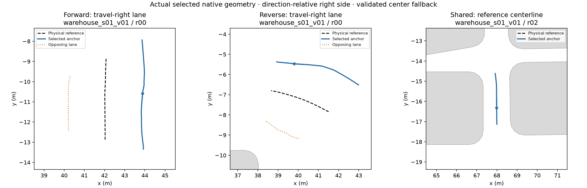
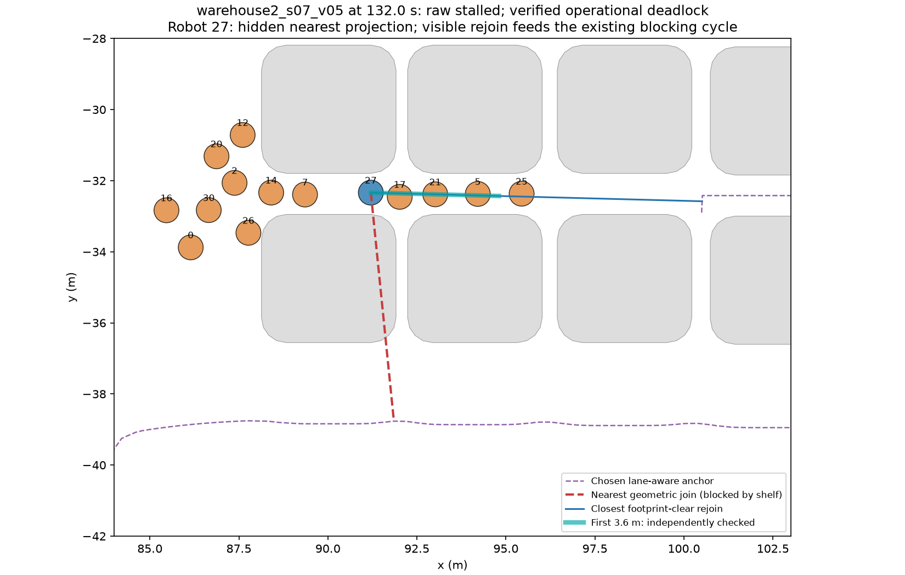
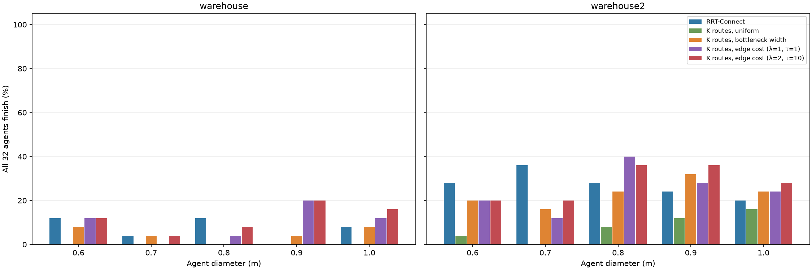
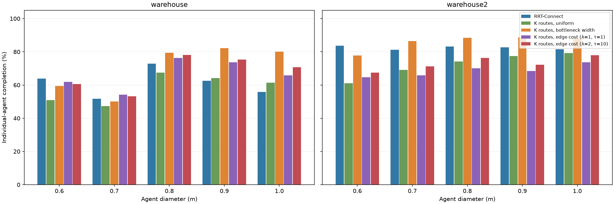
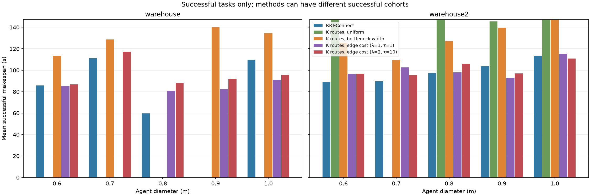
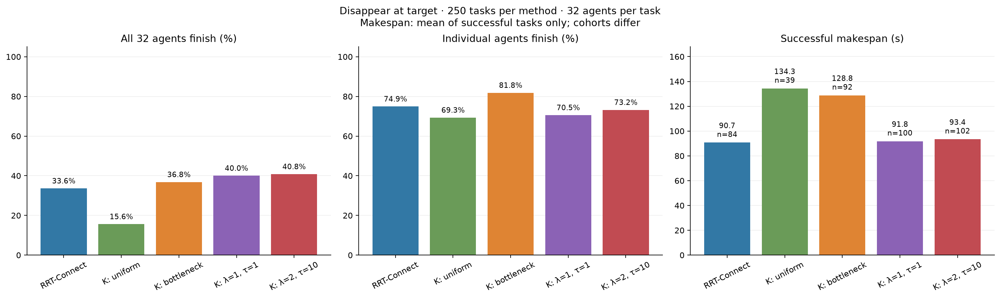

# Bottleneck-width-proportional K-route benchmark

**250 new weighted-selection runs, compared with the same 250 uniform-K and 250 RRT tasks.** Each task has 32 equal-sized disk robots. Every scenario average contains five start–goal variants.

The candidate sets are exactly the frozen keep-right sets used by the uniform baseline: requested K=5, with the actual available count recorded per agent. Only selection changes: **p_i = w_i / sum_j w_j**. One path is sampled once per agent and held for the run.

Minimum full wall-to-wall free cross-section normal to the physical reference path, before lane displacement; no radius subtraction. Polygon-vertex events and corridor endpoints are checked, including bottlenecks between reference vertices. Independent GEOS checks verify the reported wall contacts. Widths are not the clearance of the displaced right-side lane.

Both policies use seed 42. The weighted draw couples to the original uniform draw using an independent within-bin jitter, followed by inverse-CDF sampling. This has the requested width-proportional marginal probabilities and reproduces the original choice when widths are equal.

**Normal MPPI/ORCA**, not the uncertainty-aware controller, is used with the identical native binary and controller profiles: maximum forward speed 1.2 m/s, dt=0.1 s, 128 rollouts, 31 horizon states, the same shared braking safety filter and waiting policy. Observation noise is zero. Original dynamics, acceleration and yaw limits are retained. The map calibration is 1 native map unit = 1 m.

Historical baseline source versions are preserved; adding the anchor-provider interface does not change simulation, controller or stopping logic. The baseline execution checksums and unchanged controller/dynamics are verified separately from the new weighted source identity. Native candidate-generation timings are reused and explicitly recorded; makespan is simulated task-completion time.

## Right-side lane placement

On certified **SPLIT** corridor sections the anchor is strictly on the travel-right side; reverse travel swaps physical sides. `LeftOneWay` denotes reverse travel relative to canonical graph orientation and still means travel-right. On **SHARED** corridor sections the anchor equals the reference centerline. Smooth transitions and start/goal/junction connectors join these sections. The preferred offset uses half of the available footprint-safe displacement on that side, with bounded adjustments for corners, clearance and connections; it is not always exactly one quarter of the raw wall-to-wall width.

Splitting requires a certified pair of opposing, continuously clear lanes and valid connections. Conservative certification can fall back to center even where a different geometric construction might fit. These statements concern planned anchors; MPPI may leave an anchor during avoidance.

All **25,381 candidate paths** passed the independent right-side/shared-center geometry audit. Native wide-straight, reverse-direction and narrow-center tests also pass.



## Fleet success and individual completion

Fleet success requires all 32 agents physically stopped in their goal regions, valid dynamics/limits and zero continuous footprint collisions. Agent completion counts each finished robot, including runs where others deadlock. Failed makespans are undefined; means below use successful runs only.

Raw weighted terminal labels: **{'deadlock': 214, 'success': 35, 'stalled': 1}**. Verified outcomes: **{'deadlock': 215, 'success': 35}**. 1 raw stalled run(s) required an additional visible-join blocking certificate: the nearest geometric anchor projection lies behind shelving, while a footprint-clear rejoin feeds persistent traffic obstruction. The raw labels, states, controls, success flags and completion counts remain unchanged. Every unfinished robot must be covered by an independently checked blocking cycle, a parked-goal blocker, or a chain into either. `comparison_runs.csv` retains both raw and verified labels; certificates are included in the audit. Uncertified stalls reject publication.



| Method | Tasks | Fleet successes | Fleet success | Agent completion | Successful makespan (s) |
| --- | ---: | ---: | ---: | ---: | --- |
| RRT-Connect | 250 | 43 | 17.2% | 71.91% | 94.6 ± 21.2 (n=43) |
| K routes, uniform | 250 | 10 | 4.0% | 65.22% | 156.5 ± 27.1 (n=10) |
| K routes, bottleneck width | 250 | 35 | 14.0% | 78.06% | 134.2 ± 35.4 (n=35) |
| K routes, edge cost (λ=1, τ=1) | 250 | 43 | 17.2% | 67.46% | 96.1 ± 22.2 (n=43) |
| K routes, edge cost (λ=2, τ=10) | 250 | 50 | 20.0% | 70.31% | 99.2 ± 21.4 (n=50) |








## Edge-cost benchmark added

| Map | Method | Tasks | Fleet successes | Fleet success | Agent completion | Successful makespan (s) |
| --- | --- | ---: | ---: | ---: | ---: | --- |
| warehouse | RRT-Connect | 125 | 9 | 7.2% | 61.38% | 85.2 ± 28.8 (n=9) |
| warehouse | K routes, uniform | 125 | 0 | 0.0% | 58.23% | — (0 successes) |
| warehouse | K routes, bottleneck width | 125 | 6 | 4.8% | 70.25% | 127.4 ± 11.7 (n=6) |
| warehouse | K routes, edge cost (λ=1, τ=1) | 125 | 12 | 9.6% | 66.38% | 85.1 ± 17.9 (n=12) |
| warehouse | K routes, edge cost (λ=2, τ=10) | 125 | 15 | 12.0% | 67.60% | 93.0 ± 17.9 (n=15) |
| warehouse2 | RRT-Connect | 125 | 34 | 27.2% | 82.45% | 97.1 ± 18.5 (n=34) |
| warehouse2 | K routes, uniform | 125 | 10 | 8.0% | 72.22% | 156.5 ± 27.1 (n=10) |
| warehouse2 | K routes, bottleneck width | 125 | 29 | 23.2% | 85.88% | 135.6 ± 38.5 (n=29) |
| warehouse2 | K routes, edge cost (λ=1, τ=1) | 125 | 31 | 24.8% | 68.55% | 100.4 ± 22.4 (n=31) |
| warehouse2 | K routes, edge cost (λ=2, τ=10) | 125 | 35 | 28.0% | 73.02% | 101.8 ± 22.4 (n=35) |

The latest experiment uses λ = 2 and temperature τ = 10, with the same graph-only cost. [All-method report, paired makespans, scenario averages and audit](scenarios/warehouse_uniform/edge_cost_l2_t10_evaluation/REPORT.md). The historical sections below retain their original benchmark cohorts.

## Per map

| Cohort | Method | Runs | Fleet success | Agent completion | Successful makespan (s) |
| --- | --- | ---: | ---: | ---: | --- |
| warehouse | K routes, uniform | 125 | 0/125 (0.0%) | 58.2% | — (0 successes) |
| warehouse | K routes, bottleneck width | 125 | 6/125 (4.8%) | 70.2% | 127.4 ± 11.7 (n=6) |
| warehouse | RRT-Connect | 125 | 9/125 (7.2%) | 61.4% | 85.2 ± 28.8 (n=9) |
| warehouse2 | K routes, uniform | 125 | 10/125 (8.0%) | 72.2% | 156.5 ± 27.1 (n=10) |
| warehouse2 | K routes, bottleneck width | 125 | 29/125 (23.2%) | 85.9% | 135.6 ± 38.5 (n=29) |
| warehouse2 | RRT-Connect | 125 | 34/125 (27.2%) | 82.5% | 97.1 ± 18.5 (n=34) |

## Across traffic patterns, per size and map

| Cohort | Method | Runs | Fleet success | Agent completion | Successful makespan (s) |
| --- | --- | ---: | ---: | ---: | --- |
| warehouse / 0.6 | K routes, uniform | 25 | 0/25 (0.0%) | 50.9% | — (0 successes) |
| warehouse / 0.6 | K routes, bottleneck width | 25 | 2/25 (8.0%) | 59.5% | 113.4 ± 3.8 (n=2) |
| warehouse / 0.6 | RRT-Connect | 25 | 3/25 (12.0%) | 63.9% | 85.8 ± 4.3 (n=3) |
| warehouse / 0.7 | K routes, uniform | 25 | 0/25 (0.0%) | 47.2% | — (0 successes) |
| warehouse / 0.7 | K routes, bottleneck width | 25 | 1/25 (4.0%) | 50.1% | 128.6 (n=1) |
| warehouse / 0.7 | RRT-Connect | 25 | 1/25 (4.0%) | 51.7% | 111.1 (n=1) |
| warehouse / 0.8 | K routes, uniform | 25 | 0/25 (0.0%) | 67.5% | — (0 successes) |
| warehouse / 0.8 | K routes, bottleneck width | 25 | 0/25 (0.0%) | 79.4% | — (0 successes) |
| warehouse / 0.8 | RRT-Connect | 25 | 3/25 (12.0%) | 72.9% | 59.7 ± 30.2 (n=3) |
| warehouse / 0.9 | K routes, uniform | 25 | 0/25 (0.0%) | 64.1% | — (0 successes) |
| warehouse / 0.9 | K routes, bottleneck width | 25 | 1/25 (4.0%) | 82.2% | 140.1 (n=1) |
| warehouse / 0.9 | RRT-Connect | 25 | 0/25 (0.0%) | 62.5% | — (0 successes) |
| warehouse / 1.0 | K routes, uniform | 25 | 0/25 (0.0%) | 61.4% | — (0 successes) |
| warehouse / 1.0 | K routes, bottleneck width | 25 | 2/25 (8.0%) | 80.0% | 134.4 ± 4.5 (n=2) |
| warehouse / 1.0 | RRT-Connect | 25 | 2/25 (8.0%) | 55.9% | 109.8 ± 31.0 (n=2) |
| warehouse2 / 0.6 | K routes, uniform | 25 | 1/25 (4.0%) | 61.1% | 186.3 (n=1) |
| warehouse2 / 0.6 | K routes, bottleneck width | 25 | 5/25 (20.0%) | 77.8% | 125.7 ± 41.9 (n=5) |
| warehouse2 / 0.6 | RRT-Connect | 25 | 7/25 (28.0%) | 83.8% | 89.0 ± 20.2 (n=7) |
| warehouse2 / 0.7 | K routes, uniform | 25 | 0/25 (0.0%) | 69.1% | — (0 successes) |
| warehouse2 / 0.7 | K routes, bottleneck width | 25 | 4/25 (16.0%) | 86.5% | 109.5 ± 44.5 (n=4) |
| warehouse2 / 0.7 | RRT-Connect | 25 | 9/25 (36.0%) | 81.2% | 89.6 ± 18.9 (n=9) |
| warehouse2 / 0.8 | K routes, uniform | 25 | 2/25 (8.0%) | 74.1% | 156.2 ± 18.5 (n=2) |
| warehouse2 / 0.8 | K routes, bottleneck width | 25 | 6/25 (24.0%) | 88.4% | 127.0 ± 36.3 (n=6) |
| warehouse2 / 0.8 | RRT-Connect | 25 | 7/25 (28.0%) | 83.1% | 97.4 ± 20.3 (n=7) |
| warehouse2 / 0.9 | K routes, uniform | 25 | 3/25 (12.0%) | 77.5% | 145.6 ± 42.8 (n=3) |
| warehouse2 / 0.9 | K routes, bottleneck width | 25 | 8/25 (32.0%) | 88.8% | 139.7 ± 37.4 (n=8) |
| warehouse2 / 0.9 | RRT-Connect | 25 | 6/25 (24.0%) | 82.6% | 103.8 ± 8.4 (n=6) |
| warehouse2 / 1.0 | K routes, uniform | 25 | 4/25 (16.0%) | 79.2% | 157.3 ± 21.1 (n=4) |
| warehouse2 / 1.0 | K routes, bottleneck width | 25 | 6/25 (24.0%) | 88.0% | 164.5 ± 25.9 (n=6) |
| warehouse2 / 1.0 | RRT-Connect | 25 | 5/25 (20.0%) | 81.5% | 113.4 ± 12.0 (n=5) |

## Across sizes, per traffic pattern and map

| Cohort | Method | Runs | Fleet success | Agent completion | Successful makespan (s) |
| --- | --- | ---: | ---: | ---: | --- |
| warehouse / competing_bottlenecks | K routes, uniform | 25 | 0/25 (0.0%) | 34.6% | — (0 successes) |
| warehouse / competing_bottlenecks | K routes, bottleneck width | 25 | 0/25 (0.0%) | 49.9% | — (0 successes) |
| warehouse / competing_bottlenecks | RRT-Connect | 25 | 0/25 (0.0%) | 35.2% | — (0 successes) |
| warehouse / distributed | K routes, uniform | 25 | 0/25 (0.0%) | 77.0% | — (0 successes) |
| warehouse / distributed | K routes, bottleneck width | 25 | 2/25 (8.0%) | 88.5% | 138.8 ± 1.8 (n=2) |
| warehouse / distributed | RRT-Connect | 25 | 2/25 (8.0%) | 85.8% | 121.4 ± 14.6 (n=2) |
| warehouse / intersection | K routes, uniform | 25 | 0/25 (0.0%) | 68.8% | — (0 successes) |
| warehouse / intersection | K routes, bottleneck width | 25 | 0/25 (0.0%) | 81.4% | — (0 successes) |
| warehouse / intersection | RRT-Connect | 25 | 5/25 (20.0%) | 72.0% | 69.8 ± 25.6 (n=5) |
| warehouse / opposing_bottleneck | K routes, uniform | 25 | 0/25 (0.0%) | 33.0% | — (0 successes) |
| warehouse / opposing_bottleneck | K routes, bottleneck width | 25 | 0/25 (0.0%) | 44.5% | — (0 successes) |
| warehouse / opposing_bottleneck | RRT-Connect | 25 | 0/25 (0.0%) | 29.8% | — (0 successes) |
| warehouse / symmetric_swap | K routes, uniform | 25 | 0/25 (0.0%) | 77.8% | — (0 successes) |
| warehouse / symmetric_swap | K routes, bottleneck width | 25 | 4/25 (16.0%) | 87.0% | 121.7 ± 9.9 (n=4) |
| warehouse / symmetric_swap | RRT-Connect | 25 | 2/25 (8.0%) | 84.1% | 87.7 ± 0.1 (n=2) |
| warehouse2 / competing_bottlenecks | K routes, uniform | 25 | 0/25 (0.0%) | 63.4% | — (0 successes) |
| warehouse2 / competing_bottlenecks | K routes, bottleneck width | 25 | 0/25 (0.0%) | 77.1% | — (0 successes) |
| warehouse2 / competing_bottlenecks | RRT-Connect | 25 | 0/25 (0.0%) | 69.2% | — (0 successes) |
| warehouse2 / distributed | K routes, uniform | 25 | 3/25 (12.0%) | 86.6% | 159.2 ± 25.9 (n=3) |
| warehouse2 / distributed | K routes, bottleneck width | 25 | 8/25 (32.0%) | 95.6% | 163.9 ± 22.1 (n=8) |
| warehouse2 / distributed | RRT-Connect | 25 | 15/25 (60.0%) | 98.1% | 105.3 ± 12.7 (n=15) |
| warehouse2 / intersection | K routes, uniform | 25 | 1/25 (4.0%) | 78.4% | 103.3 (n=1) |
| warehouse2 / intersection | K routes, bottleneck width | 25 | 12/25 (48.0%) | 95.6% | 96.1 ± 16.7 (n=12) |
| warehouse2 / intersection | RRT-Connect | 25 | 6/25 (24.0%) | 86.1% | 67.2 ± 9.4 (n=6) |
| warehouse2 / opposing_bottleneck | K routes, uniform | 25 | 0/25 (0.0%) | 47.6% | — (0 successes) |
| warehouse2 / opposing_bottleneck | K routes, bottleneck width | 25 | 0/25 (0.0%) | 66.0% | — (0 successes) |
| warehouse2 / opposing_bottleneck | RRT-Connect | 25 | 0/25 (0.0%) | 61.6% | — (0 successes) |
| warehouse2 / symmetric_swap | K routes, uniform | 25 | 6/25 (24.0%) | 85.1% | 164.0 ± 20.3 (n=6) |
| warehouse2 / symmetric_swap | K routes, bottleneck width | 25 | 9/25 (36.0%) | 95.0% | 163.2 ± 19.4 (n=9) |
| warehouse2 / symmetric_swap | RRT-Connect | 25 | 13/25 (52.0%) | 97.1% | 101.4 ± 12.8 (n=13) |

## Evidence and data

- [Five-variant scenario averages](scenarios/warehouse_uniform/width_evaluation/comparison_by_scenario.csv)
- [Per-map averages](scenarios/warehouse_uniform/width_evaluation/comparison_by_map.csv)
- [Size averages](scenarios/warehouse_uniform/width_evaluation/comparison_by_map_size.csv)
- [Traffic-pattern averages](scenarios/warehouse_uniform/width_evaluation/comparison_by_map_pattern.csv)
- [Paired task comparisons](scenarios/warehouse_uniform/width_evaluation/paired_comparisons.csv)
- [Sampled and expected bottleneck widths](scenarios/warehouse_uniform/width_evaluation/selection_summary.csv)
- [All 8,000 weighted route draws, bottleneck widths and probabilities](scenarios/warehouse_uniform/width_evaluation/weighted_route_choices.csv)
- [All 750 planner–task outcomes](scenarios/warehouse_uniform/width_evaluation/comparison_runs.csv)
- [Independent weighted trace, width, probability and lane audit](scenarios/warehouse_uniform/width_evaluation/audit.json)
- [Width and lane preflight](scenarios/warehouse_uniform/width_evaluation/selection_preflight.json)
- [Actual recorded weighted GIFs](scenarios/warehouse_uniform/width_evaluation/animations/README.md)

Paired makespan differences use only tasks on which both compared methods finished; the sample count is recorded. Baseline traces are preserved and their prior audit checksums reverified. New raw states, controls, route probabilities and width witnesses remain under `benchmarks/results/warehouse_bottleneck_width/`.

```bash
.venv/bin/python benchmarks/multi_agent_bench.py evaluate-warehouse-width --workers 20
```

## Disappear-at-target benchmark

### Disappear-at-target only

| Method | Tasks | Fleet successes | Fleet success | Agent completion | Successful makespan (s) |
| --- | ---: | ---: | ---: | ---: | --- |
| RRT-Connect | 250 | 84 | 33.6% | 74.91% | 90.7 ± 23.4 (n=84) |
| K routes, uniform | 250 | 39 | 15.6% | 69.30% | 134.3 ± 42.6 (n=39) |
| K routes, bottleneck width | 250 | 92 | 36.8% | 81.81% | 128.8 ± 41.2 (n=92) |
| K routes, edge cost (λ=1, τ=1) | 250 | 100 | 40.0% | 70.55% | 91.8 ± 27.2 (n=100) |
| K routes, edge cost (λ=2, τ=10) | 250 | 102 | 40.8% | 73.20% | 93.4 ± 26.7 (n=102) |

| Map | Method | Tasks | Fleet successes | Fleet success | Agent completion | Successful makespan (s) |
| --- | --- | ---: | ---: | ---: | ---: | --- |
| warehouse | RRT-Connect | 125 | 26 | 20.8% | 64.30% | 88.4 ± 27.8 (n=26) |
| warehouse | K routes, uniform | 125 | 14 | 11.2% | 62.92% | 114.6 ± 49.8 (n=14) |
| warehouse | K routes, bottleneck width | 125 | 28 | 22.4% | 74.52% | 110.9 ± 49.3 (n=28) |
| warehouse | K routes, edge cost (λ=1, τ=1) | 125 | 43 | 34.4% | 70.20% | 82.5 ± 29.2 (n=43) |
| warehouse | K routes, edge cost (λ=2, τ=10) | 125 | 44 | 35.2% | 71.03% | 84.4 ± 28.3 (n=44) |
| warehouse2 | RRT-Connect | 125 | 58 | 46.4% | 85.52% | 91.7 ± 21.3 (n=58) |
| warehouse2 | K routes, uniform | 125 | 25 | 20.0% | 75.67% | 145.4 ± 34.3 (n=25) |
| warehouse2 | K routes, bottleneck width | 125 | 64 | 51.2% | 89.10% | 136.7 ± 34.7 (n=64) |
| warehouse2 | K routes, edge cost (λ=1, τ=1) | 125 | 57 | 45.6% | 70.90% | 98.8 ± 23.6 (n=57) |
| warehouse2 | K routes, edge cost (λ=2, τ=10) | 125 | 58 | 46.4% | 75.38% | 100.3 ± 23.3 (n=58) |

.

### Comparison with stay-at-target

| Method | Park: fleet success | Disappear: fleet success | Change | Agent completion: park → disappear | Successful makespan: park → disappear (s) |
| --- | ---: | ---: | ---: | ---: | ---: |
| RRT-Connect | 43/250 (17.2%) | 84/250 (33.6%) | +16.4 pp | 71.9% → 74.9% | 94.6 → 90.7 |
| K routes, uniform | 10/250 (4.0%) | 39/250 (15.6%) | +11.6 pp | 65.2% → 69.3% | 156.5 → 134.3 |
| K routes, bottleneck width | 35/250 (14.0%) | 92/250 (36.8%) | +22.8 pp | 78.1% → 81.8% | 134.2 → 128.8 |
| K routes, edge cost (λ=1, τ=1) | 43/250 (17.2%) | 100/250 (40.0%) | +22.8 pp | 67.5% → 70.5% | 96.1 → 91.8 |
| K routes, edge cost (λ=2, τ=10) | 50/250 (20.0%) | 102/250 (40.8%) | +20.8 pp | 70.3% → 73.2% | 99.2 → 93.4 |

Robots disappear after physically settling at their targets. Controller settings and sampled paths are unchanged. Successful-makespan means use different successful cohorts; matched-task comparisons are in the full report.

[Complete results, per-map tables, five-variant averages, standalone figures and audit](scenarios/warehouse_uniform/disappear_evaluation/REPORT.md).
