# Warehouse: результаты disappear-at-target

**Все 1250 прогонов завершены и проверены: 250 задач на метод, по 125 задач на каждую карту.** В задаче 32 агента одного размера; диаметры 0,6–1,0 м. Для каждого сценария есть пять вариантов стартов и финишей.

Агент исчезает после достижения своей цели и остановки по исходному критерию. Использованы обычный MPPI/ORCA, скорость до 1,2 м/с и прежние ограничения динамики. Пути, случайный выбор маршрутов и seed совпадают с прогонами stay-at-target. Это исходные наборы K-маршрутов; отдельный эксперимент без ограничения длины пути сюда не включён.

**Успешная задача:** финишировали все 32 агента. **Финишировало агентов:** доля среди всех агентов, включая неуспешные задачи. **Makespan:** время финиша последнего агента; среднее ± выборочное стандартное отклонение только по успешным задачам, `n` — их количество. У неуспешных задач makespan отсутствует.

## Disappear-at-target: общая таблица

| Метод | Успешных задач | Success rate | Финишировало агентов | Makespan, с |
| --- | ---: | ---: | ---: | --- |
| RRT-Connect | 84/250 | 33.6% | 74.91% | 90.7 ± 23.4 (n=84) |
| K-routes: uniform | 39/250 | 15.6% | 69.30% | 134.3 ± 42.6 (n=39) |
| K-routes: bottleneck | 92/250 | 36.8% | 81.81% | 128.8 ± 41.2 (n=92) |
| K-routes: λ=1, τ=1 | 100/250 | 40.0% | 70.55% | 91.8 ± 27.2 (n=100) |
| K-routes: λ=2, τ=10 | 102/250 | 40.8% | 73.20% | 93.4 ± 26.7 (n=102) |

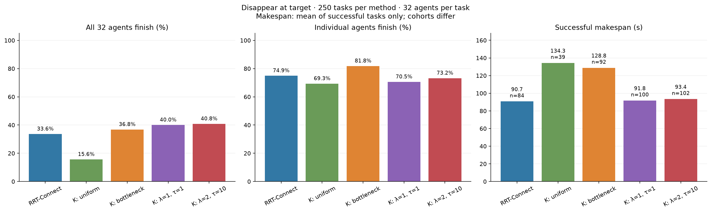

## Каждая карта отдельно

| Карта | Метод | Успешных задач | Success rate | Финишировало агентов | Makespan, с |
| --- | --- | ---: | ---: | ---: | --- |
| warehouse | RRT-Connect | 26/125 | 20.8% | 64.30% | 88.4 ± 27.8 (n=26) |
| warehouse | K-routes: uniform | 14/125 | 11.2% | 62.92% | 114.6 ± 49.8 (n=14) |
| warehouse | K-routes: bottleneck | 28/125 | 22.4% | 74.52% | 110.9 ± 49.3 (n=28) |
| warehouse | K-routes: λ=1, τ=1 | 43/125 | 34.4% | 70.20% | 82.5 ± 29.2 (n=43) |
| warehouse | K-routes: λ=2, τ=10 | 44/125 | 35.2% | 71.03% | 84.4 ± 28.3 (n=44) |
| warehouse2 | RRT-Connect | 58/125 | 46.4% | 85.52% | 91.7 ± 21.3 (n=58) |
| warehouse2 | K-routes: uniform | 25/125 | 20.0% | 75.67% | 145.4 ± 34.3 (n=25) |
| warehouse2 | K-routes: bottleneck | 64/125 | 51.2% | 89.10% | 136.7 ± 34.7 (n=64) |
| warehouse2 | K-routes: λ=1, τ=1 | 57/125 | 45.6% | 70.90% | 98.8 ± 23.6 (n=57) |
| warehouse2 | K-routes: λ=2, τ=10 | 58/125 | 46.4% | 75.38% | 100.3 ± 23.3 (n=58) |

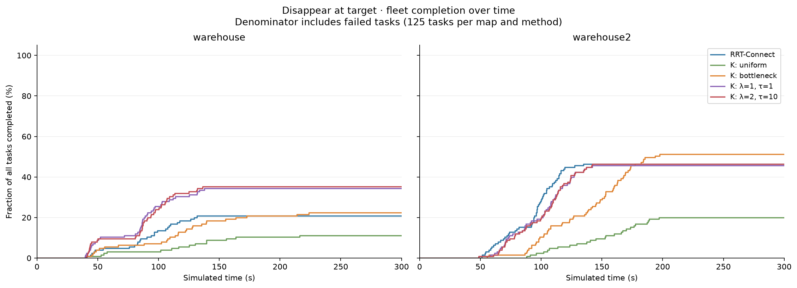

## Усреднение по размерам агентов

На каждой карте и для каждого диаметра: 25 задач = пять типов движения × пять вариантов стартов и финишей.

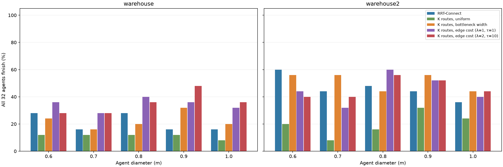

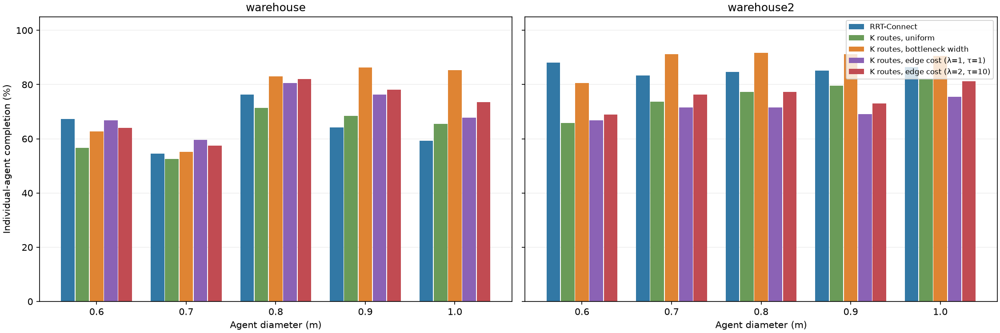

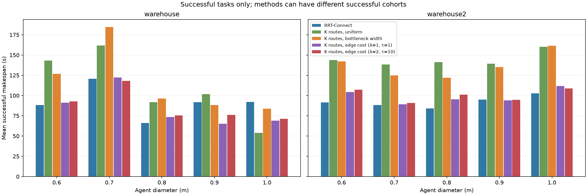

## Усреднение по типам движения

На каждой карте и для каждого типа: 25 задач = пять размеров × пять вариантов стартов и финишей.

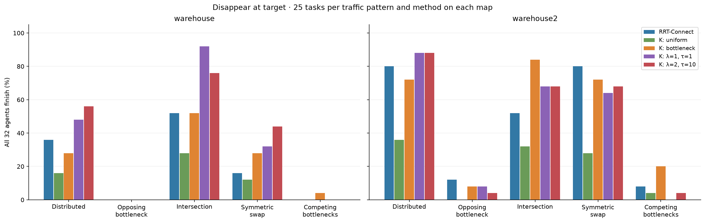

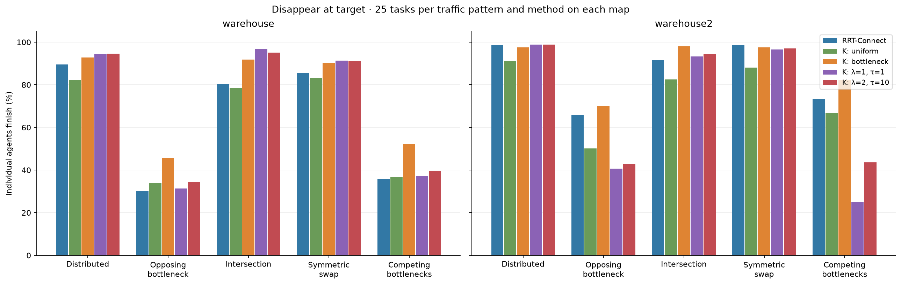

## Каждый сценарий: среднее по пяти вариантам

Одна ячейка — один сценарий, карта, размер и метод, усреднённые по пяти вариантам стартов и финишей. Поэтому success rate в этих ячейках кратен 20%.

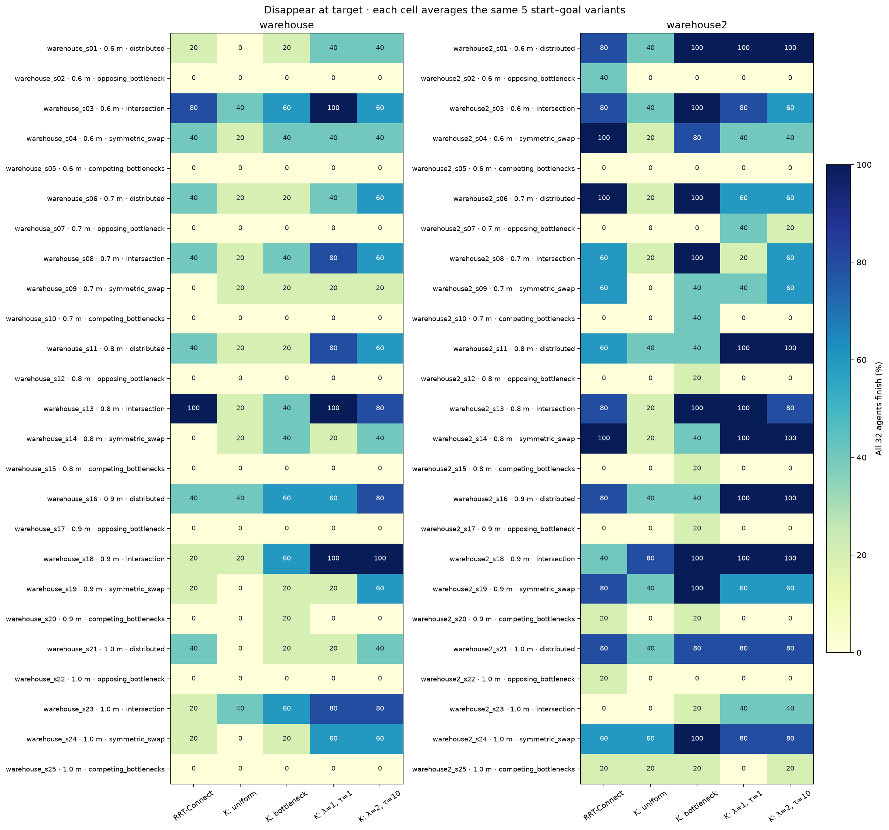

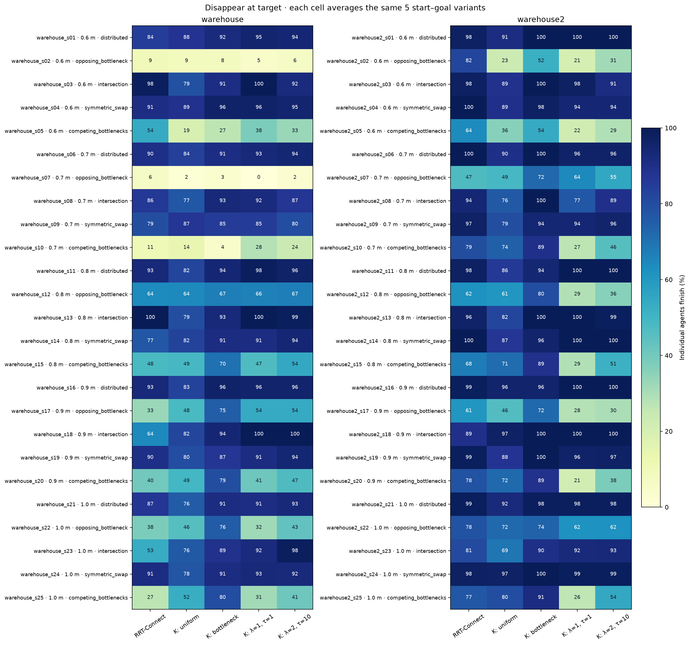

## Сравнение со stay-at-target

| Метод | Stay: успешных задач | Disappear: успешных задач | Изменение success rate |
| --- | ---: | ---: | ---: |
| RRT-Connect | 43/250 (17.2%) | 84/250 (33.6%) | +16.4 п.п. |
| K-routes: uniform | 10/250 (4.0%) | 39/250 (15.6%) | +11.6 п.п. |
| K-routes: bottleneck | 35/250 (14.0%) | 92/250 (36.8%) | +22.8 п.п. |
| K-routes: λ=1, τ=1 | 43/250 (17.2%) | 100/250 (40.0%) | +22.8 п.п. |
| K-routes: λ=2, τ=10 | 50/250 (20.0%) | 102/250 (40.8%) | +20.8 п.п. |

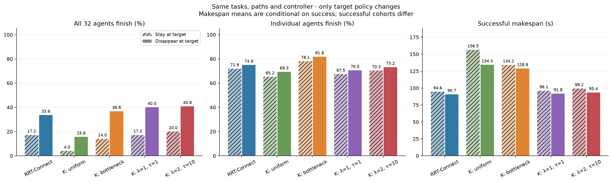

Средние makespan выше рассчитаны на разных наборах успешных задач. Следующий график сравнивает время только на тех же задачах, успешных при обоих правилах; отрицательная разница означает, что disappear быстрее.

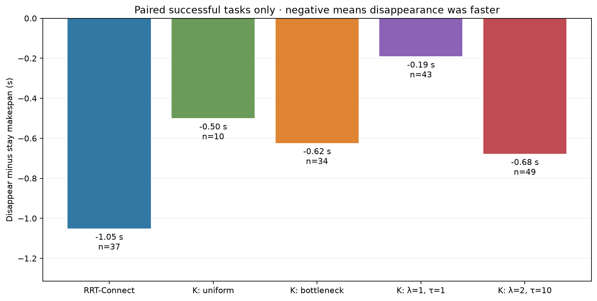

## Проверка и exception

Проверены все 1250 траекторий и 40000 запусков отдельных агентов. Столкновений и нарушений ограничений движения не обнаружено. Движение до первого исчезновения в каждом прогоне точно совпадает со stay-at-target.

Исходные терминальные статусы: `{'success': 417, 'deadlock': 832, 'stalled': 1}`. После проверки свидетельств дедлока: `{'success': 417, 'deadlock': 833}`. Неподтверждённых остановок: 0.

Exception возник в аудите: он требовал неизменности всех полей состояния исчезнувшего агента. Позиция и угол неизменны, но скорость последнего входящего шага могла быть около 1,9·10⁻⁹ м/с, а следующего — нулевой. Исправленная проверка отдельно проверяет неподвижность позиции и угла, входящую скорость по смещению и нулевые последующие скорости и управления. Также независимо проверяются прежнее время прибытия и время исчезновения: у трёх агентов они отличаются на 0,1 с. Success rate, количество финишировавших агентов и makespan задач от этого не меняются. Исходные траектории, управления и результаты прогонов сохранены; симуляции не перезапускались.

В одном графе дедлока обнаружена лишняя связь блокировки, не подтверждённая геометрией видимого подхода к маршруту. После её исключения оставшиеся проверенные связи всё ещё покрывают всех 15 незавершивших агентов: каждый находится в цикле ожидания или в очереди к такому циклу. Исходное свидетельство детектора сохранено, а подтверждённый граф записан отдельно в аудит.

## Данные

- [Полный отчёт и таблицы](scenarios/warehouse_uniform/disappear_evaluation/REPORT.md)
- [Все 1250 прогонов disappear-at-target, CSV](scenarios/warehouse_uniform/disappear_evaluation/disappear_runs.csv)
- [Средние по пяти вариантам каждого сценария, CSV](scenarios/warehouse_uniform/disappear_evaluation/disappear_by_scenario.csv)
- [Средние по размерам, CSV](scenarios/warehouse_uniform/disappear_evaluation/disappear_by_map_size.csv)
- [Средние по типам движения, CSV](scenarios/warehouse_uniform/disappear_evaluation/disappear_by_map_pattern.csv)
- [Парное сравнение со stay-at-target, CSV](scenarios/warehouse_uniform/disappear_evaluation/paired_target_policies.csv)
- [Полный аудит](scenarios/warehouse_uniform/disappear_evaluation/audit.json)

Все графики доступны в PNG и SVG: для векторной версии замените `.png` на `.svg` в имени файла.
