# Warehouse benchmark: disappear at target

**1,250 executions: 250 tasks per method, 125 per map, 32 equal-sized agents per task. Each map/scenario has five start–goal variants.**

All five methods reuse their exact original anchors and route choices on the same frozen tasks. Normal MPPI/ORCA, 1.2 m/s speed bound, bounded dynamics, braking safety filter and termination windows stay fixed. The original K-route candidate sets are reused; the separate open-route case experiment is not part of these results.

Remove a disk at the first completed timestep inside its goal tolerance with both applied controls <=1e-8; the incoming interval remains collision-checked. Exclude it from neighbors, joint safety and obstructions starting with the next interval. Keep its terminal snapshot and explicit monotone presence mask in the trace.

Fleet success means all 32 agents finish. Makespans include physically bounded deceleration to rest. Failed makespans are undefined. Means and sample standard deviations use successful tasks only; successful cohorts differ between methods and target policies.

## Disappear-at-target: all tasks

| Method | Tasks | Fleet successes | Fleet success | Agent completion | Successful makespan (s) |
| --- | ---: | ---: | ---: | ---: | --- |
| RRT-Connect | 250 | 84 | 33.6% | 74.91% | 90.7 ± 23.4 (n=84) |
| K routes, uniform | 250 | 39 | 15.6% | 69.30% | 134.3 ± 42.6 (n=39) |
| K routes, bottleneck width | 250 | 92 | 36.8% | 81.81% | 128.8 ± 41.2 (n=92) |
| K routes, edge cost (λ=1, τ=1) | 250 | 100 | 40.0% | 70.55% | 91.8 ± 27.2 (n=100) |
| K routes, edge cost (λ=2, τ=10) | 250 | 102 | 40.8% | 73.20% | 93.4 ± 26.7 (n=102) |

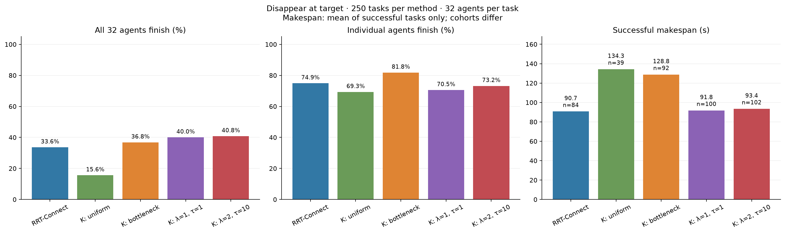

## Disappear-at-target: each map

| Map | Method | Tasks | Fleet successes | Fleet success | Agent completion | Successful makespan (s) |
| --- | --- | ---: | ---: | ---: | ---: | --- |
| warehouse | RRT-Connect | 125 | 26 | 20.8% | 64.30% | 88.4 ± 27.8 (n=26) |
| warehouse | K routes, uniform | 125 | 14 | 11.2% | 62.92% | 114.6 ± 49.8 (n=14) |
| warehouse | K routes, bottleneck width | 125 | 28 | 22.4% | 74.52% | 110.9 ± 49.3 (n=28) |
| warehouse | K routes, edge cost (λ=1, τ=1) | 125 | 43 | 34.4% | 70.20% | 82.5 ± 29.2 (n=43) |
| warehouse | K routes, edge cost (λ=2, τ=10) | 125 | 44 | 35.2% | 71.03% | 84.4 ± 28.3 (n=44) |
| warehouse2 | RRT-Connect | 125 | 58 | 46.4% | 85.52% | 91.7 ± 21.3 (n=58) |
| warehouse2 | K routes, uniform | 125 | 25 | 20.0% | 75.67% | 145.4 ± 34.3 (n=25) |
| warehouse2 | K routes, bottleneck width | 125 | 64 | 51.2% | 89.10% | 136.7 ± 34.7 (n=64) |
| warehouse2 | K routes, edge cost (λ=1, τ=1) | 125 | 57 | 45.6% | 70.90% | 98.8 ± 23.6 (n=57) |
| warehouse2 | K routes, edge cost (λ=2, τ=10) | 125 | 58 | 46.4% | 75.38% | 100.3 ± 23.3 (n=58) |

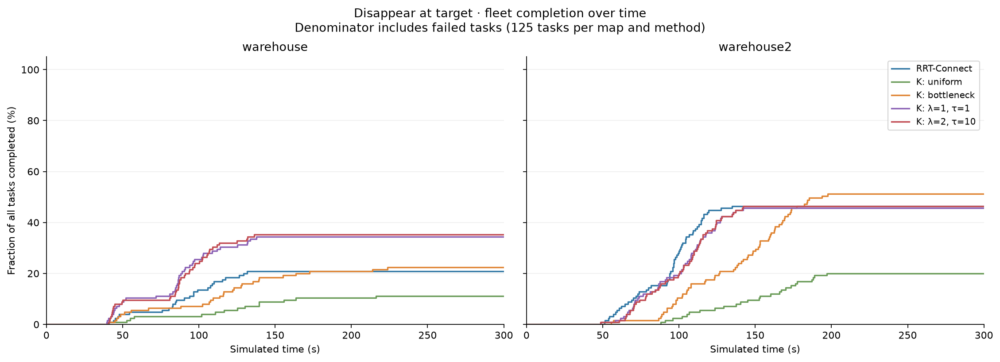

## Disappear-at-target: size averages on each map

Each row averages 25 tasks: five traffic scenarios × five start–goal variants. Agent sizes are diameters.

| Map | Method | Tasks | Fleet successes | Fleet success | Agent completion | Successful makespan (s) |
| --- | --- | ---: | ---: | ---: | ---: | --- |
| warehouse / 0.6 m | RRT-Connect | 25 | 7 | 28.0% | 67.25% | 88.2 ± 10.8 (n=7) |
| warehouse / 0.6 m | K routes, uniform | 25 | 3 | 12.0% | 56.62% | 143.3 ± 28.5 (n=3) |
| warehouse / 0.6 m | K routes, bottleneck width | 25 | 6 | 24.0% | 62.75% | 126.7 ± 25.9 (n=6) |
| warehouse / 0.6 m | K routes, edge cost (λ=1, τ=1) | 25 | 9 | 36.0% | 66.88% | 91.0 ± 9.8 (n=9) |
| warehouse / 0.6 m | K routes, edge cost (λ=2, τ=10) | 25 | 7 | 28.0% | 64.00% | 92.9 ± 10.3 (n=7) |
| warehouse / 0.7 m | RRT-Connect | 25 | 4 | 16.0% | 54.50% | 120.6 ± 10.4 (n=4) |
| warehouse / 0.7 m | K routes, uniform | 25 | 3 | 12.0% | 52.62% | 161.9 ± 47.2 (n=3) |
| warehouse / 0.7 m | K routes, bottleneck width | 25 | 4 | 16.0% | 55.25% | 184.6 ± 43.7 (n=4) |
| warehouse / 0.7 m | K routes, edge cost (λ=1, τ=1) | 25 | 7 | 28.0% | 59.62% | 122.2 ± 17.2 (n=7) |
| warehouse / 0.7 m | K routes, edge cost (λ=2, τ=10) | 25 | 7 | 28.0% | 57.50% | 118.0 ± 17.1 (n=7) |
| warehouse / 0.8 m | RRT-Connect | 25 | 7 | 28.0% | 76.38% | 66.2 ± 28.6 (n=7) |
| warehouse / 0.8 m | K routes, uniform | 25 | 3 | 12.0% | 71.38% | 91.9 ± 30.7 (n=3) |
| warehouse / 0.8 m | K routes, bottleneck width | 25 | 5 | 20.0% | 83.00% | 96.3 ± 29.6 (n=5) |
| warehouse / 0.8 m | K routes, edge cost (λ=1, τ=1) | 25 | 10 | 40.0% | 80.50% | 73.5 ± 26.8 (n=10) |
| warehouse / 0.8 m | K routes, edge cost (λ=2, τ=10) | 25 | 9 | 36.0% | 82.00% | 75.6 ± 24.1 (n=9) |
| warehouse / 0.9 m | RRT-Connect | 25 | 4 | 16.0% | 64.12% | 91.8 ± 30.6 (n=4) |
| warehouse / 0.9 m | K routes, uniform | 25 | 3 | 12.0% | 68.50% | 101.7 ± 53.6 (n=3) |
| warehouse / 0.9 m | K routes, bottleneck width | 25 | 8 | 32.0% | 86.25% | 88.2 ± 40.4 (n=8) |
| warehouse / 0.9 m | K routes, edge cost (λ=1, τ=1) | 25 | 9 | 36.0% | 76.25% | 65.2 ± 28.3 (n=9) |
| warehouse / 0.9 m | K routes, edge cost (λ=2, τ=10) | 25 | 12 | 48.0% | 78.12% | 76.2 ± 30.5 (n=12) |
| warehouse / 1.0 m | RRT-Connect | 25 | 4 | 16.0% | 59.25% | 92.0 ± 31.0 (n=4) |
| warehouse / 1.0 m | K routes, uniform | 25 | 2 | 8.0% | 65.50% | 53.9 ± 1.7 (n=2) |
| warehouse / 1.0 m | K routes, bottleneck width | 25 | 5 | 20.0% | 85.38% | 83.8 ± 48.9 (n=5) |
| warehouse / 1.0 m | K routes, edge cost (λ=1, τ=1) | 25 | 8 | 32.0% | 67.75% | 68.9 ± 22.7 (n=8) |
| warehouse / 1.0 m | K routes, edge cost (λ=2, τ=10) | 25 | 9 | 36.0% | 73.50% | 71.3 ± 26.5 (n=9) |
| warehouse2 / 0.6 m | RRT-Connect | 25 | 15 | 60.0% | 88.12% | 91.5 ± 25.6 (n=15) |
| warehouse2 / 0.6 m | K routes, uniform | 25 | 5 | 20.0% | 65.75% | 143.9 ± 43.2 (n=5) |
| warehouse2 / 0.6 m | K routes, bottleneck width | 25 | 14 | 56.0% | 80.62% | 142.0 ± 35.3 (n=14) |
| warehouse2 / 0.6 m | K routes, edge cost (λ=1, τ=1) | 25 | 11 | 44.0% | 66.75% | 104.5 ± 28.1 (n=11) |
| warehouse2 / 0.6 m | K routes, edge cost (λ=2, τ=10) | 25 | 10 | 40.0% | 69.00% | 107.3 ± 28.2 (n=10) |
| warehouse2 / 0.7 m | RRT-Connect | 25 | 11 | 44.0% | 83.38% | 88.2 ± 17.9 (n=11) |
| warehouse2 / 0.7 m | K routes, uniform | 25 | 2 | 8.0% | 73.75% | 138.3 ± 20.9 (n=2) |
| warehouse2 / 0.7 m | K routes, bottleneck width | 25 | 14 | 56.0% | 91.25% | 124.7 ± 38.0 (n=14) |
| warehouse2 / 0.7 m | K routes, edge cost (λ=1, τ=1) | 25 | 8 | 32.0% | 71.62% | 89.3 ± 20.5 (n=8) |
| warehouse2 / 0.7 m | K routes, edge cost (λ=2, τ=10) | 25 | 10 | 40.0% | 76.38% | 90.7 ± 20.6 (n=10) |
| warehouse2 / 0.8 m | RRT-Connect | 25 | 12 | 48.0% | 84.62% | 84.2 ± 23.3 (n=12) |
| warehouse2 / 0.8 m | K routes, uniform | 25 | 4 | 16.0% | 77.25% | 141.1 ± 37.6 (n=4) |
| warehouse2 / 0.8 m | K routes, bottleneck width | 25 | 11 | 44.0% | 91.75% | 122.0 ± 33.2 (n=11) |
| warehouse2 / 0.8 m | K routes, edge cost (λ=1, τ=1) | 25 | 15 | 60.0% | 71.50% | 95.3 ± 25.8 (n=15) |
| warehouse2 / 0.8 m | K routes, edge cost (λ=2, τ=10) | 25 | 14 | 56.0% | 77.25% | 100.9 ± 24.7 (n=14) |
| warehouse2 / 0.9 m | RRT-Connect | 25 | 11 | 44.0% | 85.12% | 94.9 ± 19.0 (n=11) |
| warehouse2 / 0.9 m | K routes, uniform | 25 | 8 | 32.0% | 79.62% | 139.2 ± 39.7 (n=8) |
| warehouse2 / 0.9 m | K routes, bottleneck width | 25 | 14 | 56.0% | 91.25% | 135.2 ± 31.1 (n=14) |
| warehouse2 / 0.9 m | K routes, edge cost (λ=1, τ=1) | 25 | 13 | 52.0% | 69.12% | 94.0 ± 20.6 (n=13) |
| warehouse2 / 0.9 m | K routes, edge cost (λ=2, τ=10) | 25 | 13 | 52.0% | 73.00% | 94.6 ± 22.5 (n=13) |
| warehouse2 / 1.0 m | RRT-Connect | 25 | 9 | 36.0% | 86.38% | 102.8 ± 15.4 (n=9) |
| warehouse2 / 1.0 m | K routes, uniform | 25 | 6 | 24.0% | 82.00% | 160.1 ± 25.5 (n=6) |
| warehouse2 / 1.0 m | K routes, bottleneck width | 25 | 11 | 44.0% | 90.62% | 161.6 ± 24.1 (n=11) |
| warehouse2 / 1.0 m | K routes, edge cost (λ=1, τ=1) | 25 | 10 | 40.0% | 75.50% | 111.6 ± 17.2 (n=10) |
| warehouse2 / 1.0 m | K routes, edge cost (λ=2, τ=10) | 25 | 11 | 44.0% | 81.25% | 108.7 ± 18.5 (n=11) |

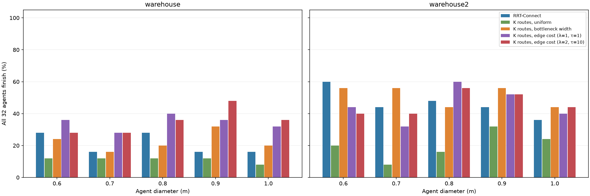

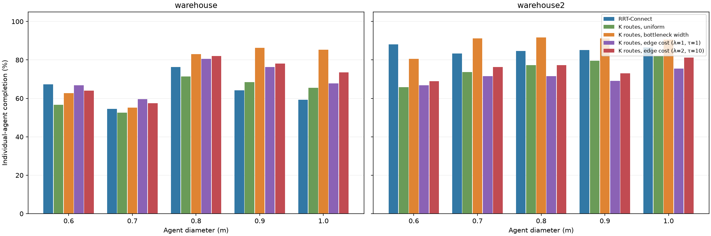

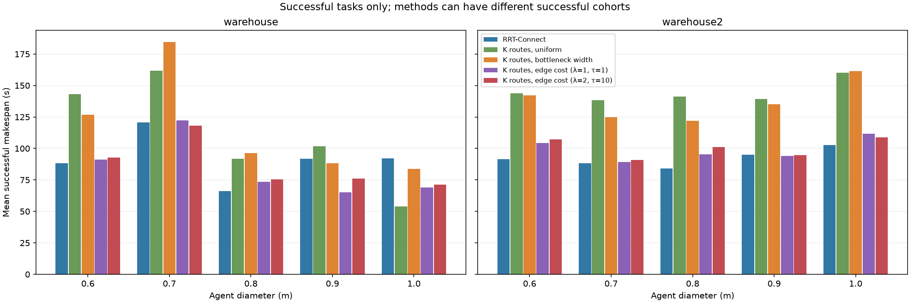

## Disappear-at-target: traffic-pattern averages on each map

Each row averages 25 tasks: five sizes × five start–goal variants.

| Map | Method | Tasks | Fleet successes | Fleet success | Agent completion | Successful makespan (s) |
| --- | --- | ---: | ---: | ---: | ---: | --- |
| warehouse / competing_bottlenecks | RRT-Connect | 25 | 0 | 0.0% | 35.88% | — (0 successes) |
| warehouse / competing_bottlenecks | K routes, uniform | 25 | 0 | 0.0% | 36.75% | — (0 successes) |
| warehouse / competing_bottlenecks | K routes, bottleneck width | 25 | 1 | 4.0% | 52.12% | 66.8 (n=1) |
| warehouse / competing_bottlenecks | K routes, edge cost (λ=1, τ=1) | 25 | 0 | 0.0% | 37.00% | — (0 successes) |
| warehouse / competing_bottlenecks | K routes, edge cost (λ=2, τ=10) | 25 | 0 | 0.0% | 39.75% | — (0 successes) |
| warehouse / distributed | RRT-Connect | 25 | 9 | 36.0% | 89.50% | 107.4 ± 13.4 (n=9) |
| warehouse / distributed | K routes, uniform | 25 | 4 | 16.0% | 82.38% | 126.5 ± 17.7 (n=4) |
| warehouse / distributed | K routes, bottleneck width | 25 | 7 | 28.0% | 92.75% | 133.4 ± 19.3 (n=7) |
| warehouse / distributed | K routes, edge cost (λ=1, τ=1) | 25 | 12 | 48.0% | 94.50% | 100.5 ± 12.9 (n=12) |
| warehouse / distributed | K routes, edge cost (λ=2, τ=10) | 25 | 14 | 56.0% | 94.62% | 102.0 ± 11.5 (n=14) |
| warehouse / intersection | RRT-Connect | 25 | 13 | 52.0% | 80.38% | 73.9 ± 31.0 (n=13) |
| warehouse / intersection | K routes, uniform | 25 | 7 | 28.0% | 78.62% | 105.9 ± 70.7 (n=7) |
| warehouse / intersection | K routes, bottleneck width | 25 | 13 | 52.0% | 91.88% | 98.5 ± 67.6 (n=13) |
| warehouse / intersection | K routes, edge cost (λ=1, τ=1) | 25 | 23 | 92.0% | 96.75% | 71.3 ± 34.6 (n=23) |
| warehouse / intersection | K routes, edge cost (λ=2, τ=10) | 25 | 19 | 76.0% | 95.12% | 67.1 ± 34.4 (n=19) |
| warehouse / opposing_bottleneck | RRT-Connect | 25 | 0 | 0.0% | 30.12% | — (0 successes) |
| warehouse / opposing_bottleneck | K routes, uniform | 25 | 0 | 0.0% | 33.75% | — (0 successes) |
| warehouse / opposing_bottleneck | K routes, bottleneck width | 25 | 0 | 0.0% | 45.75% | — (0 successes) |
| warehouse / opposing_bottleneck | K routes, edge cost (λ=1, τ=1) | 25 | 0 | 0.0% | 31.37% | — (0 successes) |
| warehouse / opposing_bottleneck | K routes, edge cost (λ=2, τ=10) | 25 | 0 | 0.0% | 34.50% | — (0 successes) |
| warehouse / symmetric_swap | RRT-Connect | 25 | 4 | 16.0% | 85.62% | 93.0 ± 10.2 (n=4) |
| warehouse / symmetric_swap | K routes, uniform | 25 | 3 | 12.0% | 83.12% | 119.1 ± 10.0 (n=3) |
| warehouse / symmetric_swap | K routes, bottleneck width | 25 | 7 | 28.0% | 90.12% | 117.6 ± 12.0 (n=7) |
| warehouse / symmetric_swap | K routes, edge cost (λ=1, τ=1) | 25 | 8 | 32.0% | 91.38% | 87.8 ± 8.9 (n=8) |
| warehouse / symmetric_swap | K routes, edge cost (λ=2, τ=10) | 25 | 11 | 44.0% | 91.12% | 91.6 ± 8.5 (n=11) |
| warehouse2 / competing_bottlenecks | RRT-Connect | 25 | 2 | 8.0% | 73.12% | 77.2 ± 6.2 (n=2) |
| warehouse2 / competing_bottlenecks | K routes, uniform | 25 | 1 | 4.0% | 66.75% | 137.3 (n=1) |
| warehouse2 / competing_bottlenecks | K routes, bottleneck width | 25 | 5 | 20.0% | 82.38% | 127.0 ± 19.2 (n=5) |
| warehouse2 / competing_bottlenecks | K routes, edge cost (λ=1, τ=1) | 25 | 0 | 0.0% | 25.00% | — (0 successes) |
| warehouse2 / competing_bottlenecks | K routes, edge cost (λ=2, τ=10) | 25 | 1 | 4.0% | 43.62% | 82.2 (n=1) |
| warehouse2 / distributed | RRT-Connect | 25 | 20 | 80.0% | 98.50% | 106.3 ± 13.2 (n=20) |
| warehouse2 / distributed | K routes, uniform | 25 | 9 | 36.0% | 91.00% | 165.9 ± 17.1 (n=9) |
| warehouse2 / distributed | K routes, bottleneck width | 25 | 18 | 72.0% | 97.62% | 163.3 ± 16.4 (n=18) |
| warehouse2 / distributed | K routes, edge cost (λ=1, τ=1) | 25 | 22 | 88.0% | 98.88% | 115.9 ± 13.8 (n=22) |
| warehouse2 / distributed | K routes, edge cost (λ=2, τ=10) | 25 | 22 | 88.0% | 98.88% | 117.7 ± 13.4 (n=22) |
| warehouse2 / intersection | RRT-Connect | 25 | 13 | 52.0% | 91.50% | 63.0 ± 8.9 (n=13) |
| warehouse2 / intersection | K routes, uniform | 25 | 8 | 32.0% | 82.50% | 103.3 ± 11.8 (n=8) |
| warehouse2 / intersection | K routes, bottleneck width | 25 | 21 | 84.0% | 98.00% | 98.7 ± 19.0 (n=21) |
| warehouse2 / intersection | K routes, edge cost (λ=1, τ=1) | 25 | 17 | 68.0% | 93.38% | 69.6 ± 9.7 (n=17) |
| warehouse2 / intersection | K routes, edge cost (λ=2, τ=10) | 25 | 17 | 68.0% | 94.50% | 71.7 ± 10.5 (n=17) |
| warehouse2 / opposing_bottleneck | RRT-Connect | 25 | 3 | 12.0% | 65.88% | 69.5 ± 21.3 (n=3) |
| warehouse2 / opposing_bottleneck | K routes, uniform | 25 | 0 | 0.0% | 50.12% | — (0 successes) |
| warehouse2 / opposing_bottleneck | K routes, bottleneck width | 25 | 2 | 8.0% | 70.00% | 112.0 ± 33.3 (n=2) |
| warehouse2 / opposing_bottleneck | K routes, edge cost (λ=1, τ=1) | 25 | 2 | 8.0% | 40.75% | 83.5 ± 3.5 (n=2) |
| warehouse2 / opposing_bottleneck | K routes, edge cost (λ=2, τ=10) | 25 | 1 | 4.0% | 42.88% | 77.9 (n=1) |
| warehouse2 / symmetric_swap | RRT-Connect | 25 | 20 | 80.0% | 98.62% | 100.7 ± 10.8 (n=20) |
| warehouse2 / symmetric_swap | K routes, uniform | 25 | 7 | 28.0% | 88.00% | 168.2 ± 23.0 (n=7) |
| warehouse2 / symmetric_swap | K routes, bottleneck width | 25 | 18 | 72.0% | 97.50% | 159.8 ± 20.4 (n=18) |
| warehouse2 / symmetric_swap | K routes, edge cost (λ=1, τ=1) | 25 | 16 | 64.0% | 96.50% | 108.3 ± 13.6 (n=16) |
| warehouse2 / symmetric_swap | K routes, edge cost (λ=2, τ=10) | 25 | 17 | 68.0% | 97.00% | 108.8 ± 13.3 (n=17) |

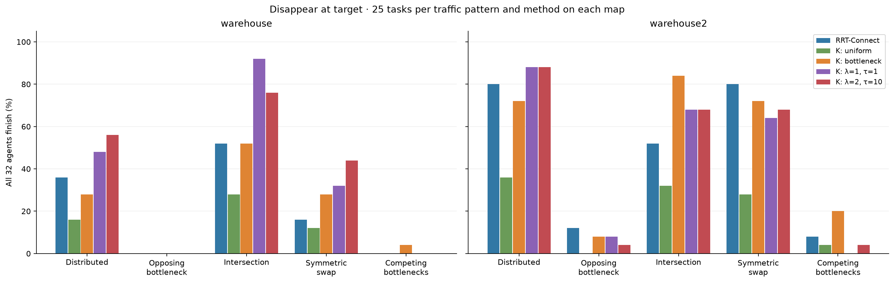

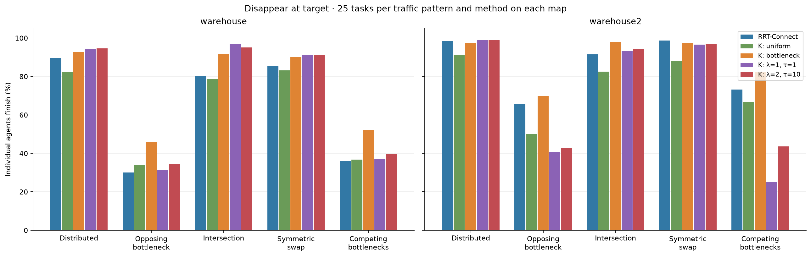

## Disappear-at-target: every scenario, five variants

Every cell below averages exactly five start–goal variants for one scenario, agent size, map and method. Fleet success therefore changes in increments of 20 percentage points. [All 250 scenario/method averages](disappear_by_scenario.csv).

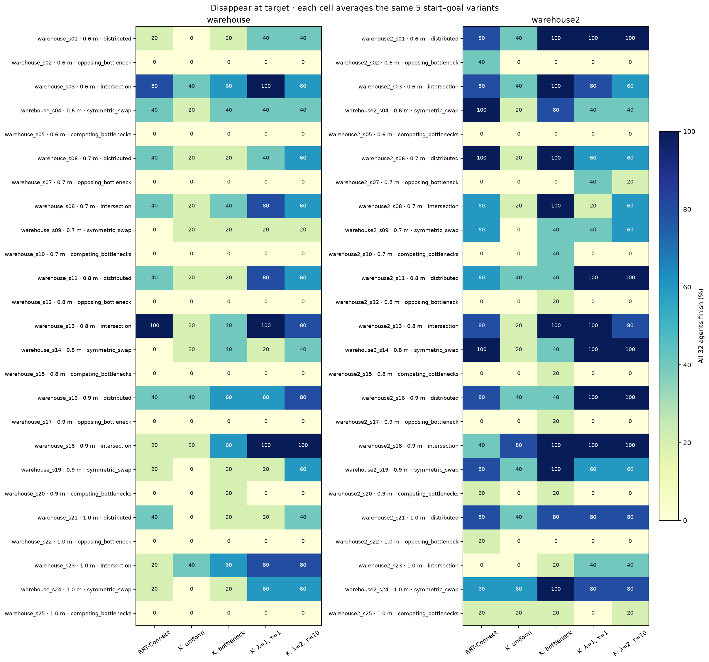

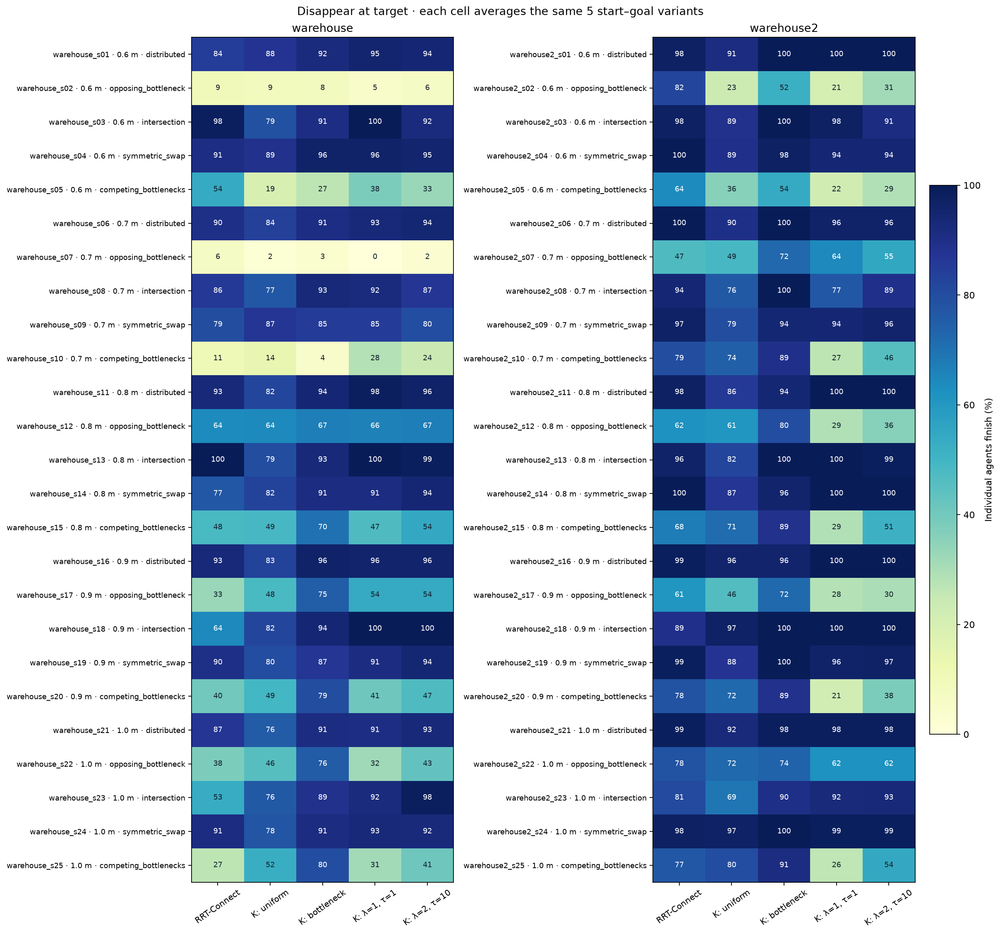

## Stay-at-target versus disappear-at-target

| Method | Park: fleet success | Disappear: fleet success | Change | Agent completion: park → disappear | Successful makespan: park → disappear (s) |
| --- | ---: | ---: | ---: | ---: | ---: |
| RRT-Connect | 43/250 (17.2%) | 84/250 (33.6%) | +16.4 pp | 71.9% → 74.9% | 94.6 → 90.7 |
| K routes, uniform | 10/250 (4.0%) | 39/250 (15.6%) | +11.6 pp | 65.2% → 69.3% | 156.5 → 134.3 |
| K routes, bottleneck width | 35/250 (14.0%) | 92/250 (36.8%) | +22.8 pp | 78.1% → 81.8% | 134.2 → 128.8 |
| K routes, edge cost (λ=1, τ=1) | 43/250 (17.2%) | 100/250 (40.0%) | +22.8 pp | 67.5% → 70.5% | 96.1 → 91.8 |
| K routes, edge cost (λ=2, τ=10) | 50/250 (20.0%) | 102/250 (40.8%) | +20.8 pp | 70.3% → 73.2% | 99.2 → 93.4 |

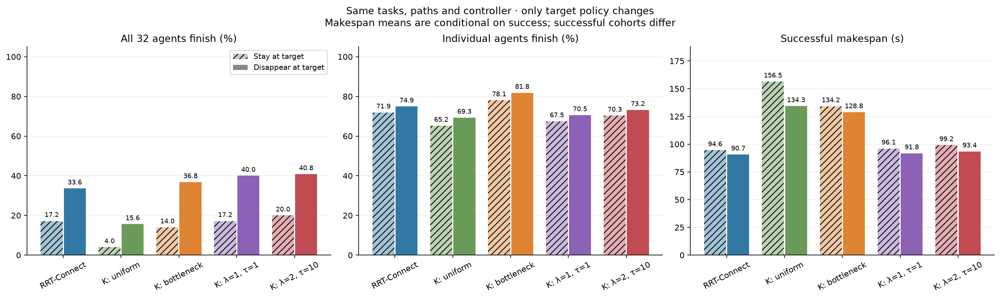

## Audit and the original exception

Audited 1250 new runs / 40000 agent executions, with zero collisions or motion-limit violations. All 1250 runs reproduce the parked baseline exactly up to and including the first disappearance. Raw outcomes: `{'success': 417, 'deadlock': 832, 'stalled': 1}`. Verified outcomes: `{'success': 417, 'deadlock': 833}`. Unresolved stalls remain failures.

The original final audit stopped with `Removed snapshot moved` for agent 3 in `warehouse_s04_v01 / rrt`. Its x, y and heading remain exactly constant after removal. On the removal sample, the recorded Cartesian velocity describes the last incoming interval (at most 1.873e-9 m/s in a component); the following zero-displacement samples have zero velocity. The corrected audit checks fixed poses exactly, incoming velocity against the measured incoming displacement, zero later velocity and zero outgoing controls. No trajectories, controls, arrival times or success flags were edited, and no simulations were rerun.

The legacy individual-arrival metric uses a 1e-6 state-speed/yaw-rate threshold; disappearance uses a stricter 1e-8 applied-control threshold. The audit independently reconstructs both. 3 agent records have an earlier legacy arrival by 0.1 s; fleet success, completion counts and every reported fleet makespan agree with actual disappearance times. The differences are recorded in `audit.json`, and raw per-agent timestamps remain unchanged.

1 deadlock record(s) contained a redundant edge not corroborated after choosing a footprint-clear visible route join. For these records, every raw edge is checked independently, unsupported edges are excluded from the certificate, and the remaining graph must still cover every unfinished agent through persistent cycles or chains into cycles. The raw detector evidence remains unchanged; certificates list both rejected and retained edges.

## Matched successful tasks

Negative differences below mean disappearance was faster on the same successful tasks.

| Method | Both policies successful | Disappear minus park makespan (s) | Gained successes | Lost successes |
| --- | ---: | ---: | ---: | ---: |
| RRT-Connect | 37 | -1.05 | 47 | 6 |
| K routes, uniform | 10 | -0.50 | 29 | 0 |
| K routes, bottleneck width | 34 | -0.62 | 58 | 1 |
| K routes, edge cost (λ=1, τ=1) | 43 | -0.19 | 57 | 0 |
| K routes, edge cost (λ=2, τ=10) | 49 | -0.68 | 53 | 1 |

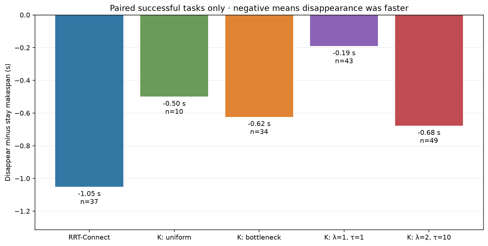

## Downloadable data

[Disappear only: all 1,250 executions](disappear_runs.csv). [Overall table](disappear_overall.csv). [Per-map table](disappear_by_map.csv). [Five start–goal variant averages per scenario](disappear_by_scenario.csv). [Averages by size](disappear_by_map_size.csv). [Averages by traffic pattern](disappear_by_map_pattern.csv). [Both target policies, every run](comparison_runs.csv). [Paired policy changes](paired_target_policies.csv). [Audit](audit.json).

All figures are supplied as PNG and SVG.

Audit and rebuild this report without rerunning simulations: `OPENBLAS_NUM_THREADS=1 OMP_NUM_THREADS=1 PYTHONPATH=benchmarks .venv/bin/python -m multi_agent.warehouse_disappear_report --workers 8`.
