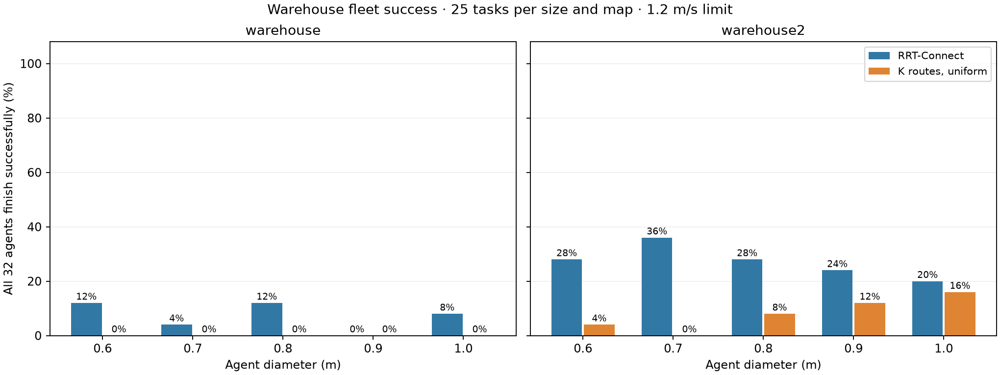
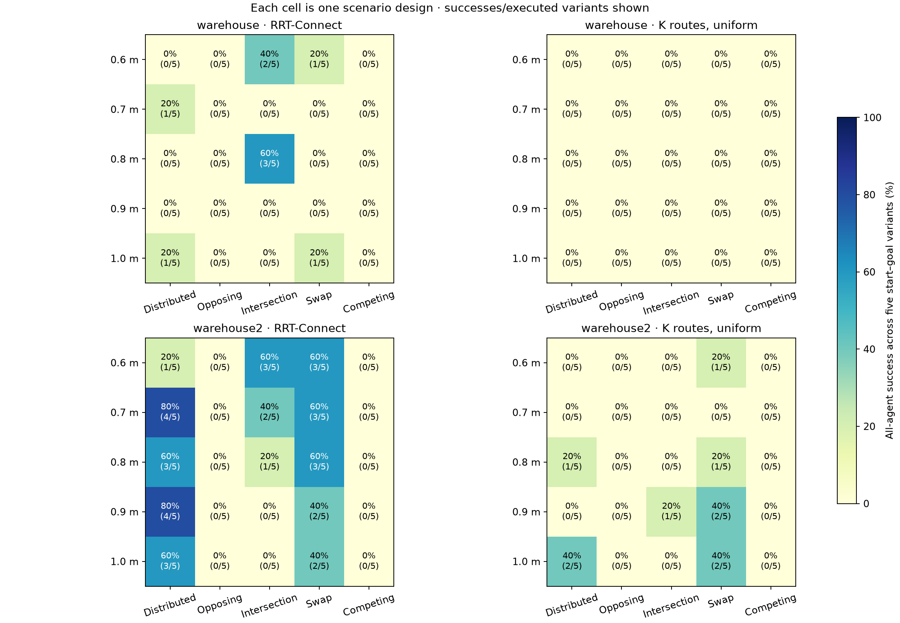
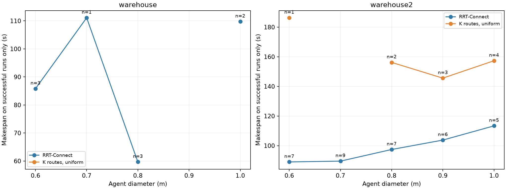

# Warehouse MPPI/ORCA routing comparison

**500/500 planner–task runs.** Each method uses the same 250 frozen assignments: 25 scenario designs × five start–goal variants × two maps, with 32 identical agents per task.

Forward speed is bounded at **1.2 m/s**, matching the maximum translational speed in [OMRON's LD-250 manual](https://assets.omron.eu/downloads/manual/en/v3/i642_ld-250_user_s_guide_users_manual_en.pdf). The benchmark convention remains 1 map unit = 1 m. Existing physical limits are acceleration 0.8 m/s², braking 1.2 m/s², yaw rate ±1.8 rad/s and yaw acceleration 2 rad/s². The native fallback's angular-rate jump was corrected; both methods use that same binary, original unicycle integration and physical parking. Differential-drive anchor projection also requires a clear swept-footprint connection, preventing false progress onto a later aisle across shelving. Guided proposals include a bounded turn in place toward that visible join before moving; off-anchor heading cost points toward the join and blends back to the path tangent as the robot reacquires it.

The common controller yields after 15 seconds without 0.15 m of route or best-goal improvement, when a stationary robot has blocked route reacquisition or the forward planning horizon for at least three seconds. MPPI/ORCA is still evaluated; the controller chooses its bounded braking sequence while waiting and resumes after two seconds clear. This suppresses repeated low-speed avoidance oscillations without changing poses, anchors, motion bounds or the deadlock detector.

The common MPPI profile uses 128 rollouts and 31 horizon states at dt=0.1 s (3.0 seconds of control horizon), with ORCA enabled. Both methods use the same synchronous joint safety filter: each proposed fleet command must have a continuously collision-free, bounded-braking continuation to rest. Unsafe proposals fall back to the previous certified stop, with safe progress retained by unaffected robots. This is MPPI/ORCA **with a shared safety layer**, not a safety guarantee supplied by decentralized ORCA alone. The certificate assumes exact synchronous states and the documented unicycle dynamics. Its clearance reserve is 0.04 m from static obstacles and 0.08 m between physical robot bodies (two per-agent margins). Task feasibility uses its declared 0.04 m inter-body margin; the controller's larger pair reserve is a common conservative policy for both routing methods.

RRT uses independent RRT-Connect queries with configuration-space triangulation biasing its samples; uniform exploration is retained, and the mesh never supplies a fallback output path. Each query has a 100,000-iteration ceiling, a 1.5 m extension step and 800 shortcut attempts. K requests up to five radius-aware keep-right routes with 24 physical candidates, a 1.8 detour ratio and 0.2 diversity threshold, and selects each agent's route uniformly from the returned set. Planner-selection seed and controller seed are both 42, held fixed across the paired tasks.

Success requires all 32 agents stopped inside their assigned 0.35 m goal regions, zero measured footprint collisions, and valid measured dynamics and control bounds. Agent completion is the fraction settled when the run terminates. Every evaluated assignment also has a separately replayed constructive joint completion schedule, including bounded controls and every stationary robot. These schedules are validation evidence and are never used as anchor paths or controller fallbacks. Six original endpoint variants lacked such certificates and were replaced using geometry and joint feasibility, before final measurements. Their original files and repair history are preserved under the scenario suite's `revisions/` directory; no MPPI outcome selects a replacement.

A deadlock needs 30 seconds of stationary/no-progress evidence and persistent directed obstruction accounting for every unfinished agent: cycles, queues into cycles, or queues into robots permanently parked at their goals. Its evidence records the blocking IDs, directed edges and the deadlock subtype. A blocking disk must persistently intersect the agent's forward route within the common 3-second MPPI horizon (3.6 m at maximum speed), including route reacquisition. This describes observed controller deadlock under the fixed routes and parking policy. An isolated stall or livelock needs 45 seconds without route or best-goal improvement for all unfinished agents, and is reported separately. Planning failure, collision and observation limits are also explicit outcomes. They remain in the task-success denominator. Finite observation does not prove mathematical deadlock or impossibility of eventual recovery.

**Makespan is simulated time until the entire fleet finishes.** The reported mean ± sample standard deviation uses successful runs only; `(n=...)` is its sample count. Failed makespans are null. No failure is averaged as zero. Therefore a cohort with no full-fleet successes has no measured makespan.

## Overall

| Routing | Runs | Global plans received | Fleet successes | Fleet success | Mean agent completion | Successful makespan (s) |
| --- | ---: | ---: | ---: | ---: | ---: | --- |
| k_routes | 250 | 250 | 10 | 4.0% | 65.2% | 156.5 ± 27.1 (n=10) |
| rrt | 250 | 250 | 43 | 17.2% | 71.9% | 94.6 ± 21.2 (n=43) |

The fleet-success denominator above includes global planning failures. The following view isolates controller behavior after all 32 anchors were available.

| Routing | Simulated tasks | Fleet success given global plans | Mean agent completion given global plans |
| --- | ---: | ---: | ---: |
| k_routes | 250 | 4.0% | 65.2% |
| rrt | 250 | 17.2% | 71.9% |

**Fleet success and agent completion are different measurements.** Fleet success requires every one of the 32 robots to finish. Agent completion counts each finished robot, including those in a run where others deadlocked.

| Routing | Finished agents / assigned agents | Agent completion | All-32 fleet success |
| --- | ---: | ---: | ---: |
| rrt | 5753/8000 | 71.9% | 43/250 (17.2%) |
| k_routes | 5218/8000 | 65.2% | 10/250 (4.0%) |

## Requested K and actual returned route sets

K=5 is the requested upper bound. Each agent samples uniformly from its returned set. A shortfall can follow from the bounded search and diversity filters; it is not a certificate that no further feasible routes exist.

| Map | Agent queries | 1 returned | 2 returned | 3 returned | 4 returned | 5 returned | Mean returned K |
| --- | ---: | ---: | ---: | ---: | ---: | ---: | ---: |
| warehouse | 4000 | 593 | 1346 | 887 | 352 | 822 | 2.866 |
| warehouse2 | 4000 | 538 | 603 | 677 | 768 | 1414 | 3.479 |

[Actual route-count data](route_availability.csv)

[Review of the low success rates and controlled diagnostic runs](REVIEW.md)


## Outcomes

| Outcome | RRT-Connect | K routes, uniform |
| --- | ---: | ---: |
| deadlock | 207 | 240 |
| success | 43 | 10 |







## Average across traffic patterns for each size and map

| Cohort | Method | Runs | Fleet success | Mean agent completion | Successful makespan (s) |
| --- | --- | ---: | ---: | ---: | --- |
| warehouse / 0.6 | k_routes | 25 | 0.0% (0/25) | 50.9% | — (0 successes) |
| warehouse / 0.6 | rrt | 25 | 12.0% (3/25) | 63.9% | 85.8 ± 4.3 (n=3) |
| warehouse / 0.7 | k_routes | 25 | 0.0% (0/25) | 47.2% | — (0 successes) |
| warehouse / 0.7 | rrt | 25 | 4.0% (1/25) | 51.7% | 111.1 (n=1) |
| warehouse / 0.8 | k_routes | 25 | 0.0% (0/25) | 67.5% | — (0 successes) |
| warehouse / 0.8 | rrt | 25 | 12.0% (3/25) | 72.9% | 59.7 ± 30.2 (n=3) |
| warehouse / 0.9 | k_routes | 25 | 0.0% (0/25) | 64.1% | — (0 successes) |
| warehouse / 0.9 | rrt | 25 | 0.0% (0/25) | 62.5% | — (0 successes) |
| warehouse / 1.0 | k_routes | 25 | 0.0% (0/25) | 61.4% | — (0 successes) |
| warehouse / 1.0 | rrt | 25 | 8.0% (2/25) | 55.9% | 109.8 ± 31.0 (n=2) |
| warehouse2 / 0.6 | k_routes | 25 | 4.0% (1/25) | 61.1% | 186.3 (n=1) |
| warehouse2 / 0.6 | rrt | 25 | 28.0% (7/25) | 83.8% | 89.0 ± 20.2 (n=7) |
| warehouse2 / 0.7 | k_routes | 25 | 0.0% (0/25) | 69.1% | — (0 successes) |
| warehouse2 / 0.7 | rrt | 25 | 36.0% (9/25) | 81.2% | 89.6 ± 18.9 (n=9) |
| warehouse2 / 0.8 | k_routes | 25 | 8.0% (2/25) | 74.1% | 156.2 ± 18.5 (n=2) |
| warehouse2 / 0.8 | rrt | 25 | 28.0% (7/25) | 83.1% | 97.4 ± 20.3 (n=7) |
| warehouse2 / 0.9 | k_routes | 25 | 12.0% (3/25) | 77.5% | 145.6 ± 42.8 (n=3) |
| warehouse2 / 0.9 | rrt | 25 | 24.0% (6/25) | 82.6% | 103.8 ± 8.4 (n=6) |
| warehouse2 / 1.0 | k_routes | 25 | 16.0% (4/25) | 79.2% | 157.3 ± 21.1 (n=4) |
| warehouse2 / 1.0 | rrt | 25 | 20.0% (5/25) | 81.5% | 113.4 ± 12.0 (n=5) |

## Average across all sizes and traffic patterns for each map

| Cohort | Method | Runs | Fleet success | Mean agent completion | Successful makespan (s) |
| --- | --- | ---: | ---: | ---: | --- |
| warehouse | k_routes | 125 | 0.0% (0/125) | 58.2% | — (0 successes) |
| warehouse | rrt | 125 | 7.2% (9/125) | 61.4% | 85.2 ± 28.8 (n=9) |
| warehouse2 | k_routes | 125 | 8.0% (10/125) | 72.2% | 156.5 ± 27.1 (n=10) |
| warehouse2 | rrt | 125 | 27.2% (34/125) | 82.5% | 97.1 ± 18.5 (n=34) |

## Average across sizes for each traffic pattern and map

| Cohort | Method | Runs | Fleet success | Mean agent completion | Successful makespan (s) |
| --- | --- | ---: | ---: | ---: | --- |
| warehouse / competing_bottlenecks | k_routes | 25 | 0.0% (0/25) | 34.6% | — (0 successes) |
| warehouse / competing_bottlenecks | rrt | 25 | 0.0% (0/25) | 35.2% | — (0 successes) |
| warehouse / distributed | k_routes | 25 | 0.0% (0/25) | 77.0% | — (0 successes) |
| warehouse / distributed | rrt | 25 | 8.0% (2/25) | 85.8% | 121.4 ± 14.6 (n=2) |
| warehouse / intersection | k_routes | 25 | 0.0% (0/25) | 68.8% | — (0 successes) |
| warehouse / intersection | rrt | 25 | 20.0% (5/25) | 72.0% | 69.8 ± 25.6 (n=5) |
| warehouse / opposing_bottleneck | k_routes | 25 | 0.0% (0/25) | 33.0% | — (0 successes) |
| warehouse / opposing_bottleneck | rrt | 25 | 0.0% (0/25) | 29.8% | — (0 successes) |
| warehouse / symmetric_swap | k_routes | 25 | 0.0% (0/25) | 77.8% | — (0 successes) |
| warehouse / symmetric_swap | rrt | 25 | 8.0% (2/25) | 84.1% | 87.7 ± 0.1 (n=2) |
| warehouse2 / competing_bottlenecks | k_routes | 25 | 0.0% (0/25) | 63.4% | — (0 successes) |
| warehouse2 / competing_bottlenecks | rrt | 25 | 0.0% (0/25) | 69.2% | — (0 successes) |
| warehouse2 / distributed | k_routes | 25 | 12.0% (3/25) | 86.6% | 159.2 ± 25.9 (n=3) |
| warehouse2 / distributed | rrt | 25 | 60.0% (15/25) | 98.1% | 105.3 ± 12.7 (n=15) |
| warehouse2 / intersection | k_routes | 25 | 4.0% (1/25) | 78.4% | 103.3 (n=1) |
| warehouse2 / intersection | rrt | 25 | 24.0% (6/25) | 86.1% | 67.2 ± 9.4 (n=6) |
| warehouse2 / opposing_bottleneck | k_routes | 25 | 0.0% (0/25) | 47.6% | — (0 successes) |
| warehouse2 / opposing_bottleneck | rrt | 25 | 0.0% (0/25) | 61.6% | — (0 successes) |
| warehouse2 / symmetric_swap | k_routes | 25 | 24.0% (6/25) | 85.1% | 164.0 ± 20.3 (n=6) |
| warehouse2 / symmetric_swap | rrt | 25 | 52.0% (13/25) | 97.1% | 101.4 ± 12.8 (n=13) |

## Five start–goal variants per scenario and map

| Cohort | Method | Runs | Fleet success | Mean agent completion | Successful makespan (s) |
| --- | --- | ---: | ---: | ---: | --- |
| warehouse / warehouse_s01 / 0.6 / distributed | k_routes | 5 | 0.0% (0/5) | 81.9% | — (0 successes) |
| warehouse / warehouse_s01 / 0.6 / distributed | rrt | 5 | 0.0% (0/5) | 78.1% | — (0 successes) |
| warehouse / warehouse_s02 / 0.6 / opposing_bottleneck | k_routes | 5 | 0.0% (0/5) | 8.8% | — (0 successes) |
| warehouse / warehouse_s02 / 0.6 / opposing_bottleneck | rrt | 5 | 0.0% (0/5) | 8.8% | — (0 successes) |
| warehouse / warehouse_s03 / 0.6 / intersection | k_routes | 5 | 0.0% (0/5) | 67.5% | — (0 successes) |
| warehouse / warehouse_s03 / 0.6 / intersection | rrt | 5 | 40.0% (2/5) | 93.1% | 84.9 ± 5.7 (n=2) |
| warehouse / warehouse_s04 / 0.6 / symmetric_swap | k_routes | 5 | 0.0% (0/5) | 80.0% | — (0 successes) |
| warehouse / warehouse_s04 / 0.6 / symmetric_swap | rrt | 5 | 20.0% (1/5) | 90.0% | 87.6 (n=1) |
| warehouse / warehouse_s05 / 0.6 / competing_bottlenecks | k_routes | 5 | 0.0% (0/5) | 16.2% | — (0 successes) |
| warehouse / warehouse_s05 / 0.6 / competing_bottlenecks | rrt | 5 | 0.0% (0/5) | 49.4% | — (0 successes) |
| warehouse / warehouse_s06 / 0.7 / distributed | k_routes | 5 | 0.0% (0/5) | 78.1% | — (0 successes) |
| warehouse / warehouse_s06 / 0.7 / distributed | rrt | 5 | 20.0% (1/5) | 87.5% | 111.1 (n=1) |
| warehouse / warehouse_s07 / 0.7 / opposing_bottleneck | k_routes | 5 | 0.0% (0/5) | 1.9% | — (0 successes) |
| warehouse / warehouse_s07 / 0.7 / opposing_bottleneck | rrt | 5 | 0.0% (0/5) | 5.6% | — (0 successes) |
| warehouse / warehouse_s08 / 0.7 / intersection | k_routes | 5 | 0.0% (0/5) | 70.0% | — (0 successes) |
| warehouse / warehouse_s08 / 0.7 / intersection | rrt | 5 | 0.0% (0/5) | 75.0% | — (0 successes) |
| warehouse / warehouse_s09 / 0.7 / symmetric_swap | k_routes | 5 | 0.0% (0/5) | 78.1% | — (0 successes) |
| warehouse / warehouse_s09 / 0.7 / symmetric_swap | rrt | 5 | 0.0% (0/5) | 78.1% | — (0 successes) |
| warehouse / warehouse_s10 / 0.7 / competing_bottlenecks | k_routes | 5 | 0.0% (0/5) | 8.1% | — (0 successes) |
| warehouse / warehouse_s10 / 0.7 / competing_bottlenecks | rrt | 5 | 0.0% (0/5) | 12.5% | — (0 successes) |
| warehouse / warehouse_s11 / 0.8 / distributed | k_routes | 5 | 0.0% (0/5) | 78.8% | — (0 successes) |
| warehouse / warehouse_s11 / 0.8 / distributed | rrt | 5 | 0.0% (0/5) | 90.0% | — (0 successes) |
| warehouse / warehouse_s12 / 0.8 / opposing_bottleneck | k_routes | 5 | 0.0% (0/5) | 60.6% | — (0 successes) |
| warehouse / warehouse_s12 / 0.8 / opposing_bottleneck | rrt | 5 | 0.0% (0/5) | 62.5% | — (0 successes) |
| warehouse / warehouse_s13 / 0.8 / intersection | k_routes | 5 | 0.0% (0/5) | 68.8% | — (0 successes) |
| warehouse / warehouse_s13 / 0.8 / intersection | rrt | 5 | 60.0% (3/5) | 92.5% | 59.7 ± 30.2 (n=3) |
| warehouse / warehouse_s14 / 0.8 / symmetric_swap | k_routes | 5 | 0.0% (0/5) | 81.9% | — (0 successes) |
| warehouse / warehouse_s14 / 0.8 / symmetric_swap | rrt | 5 | 0.0% (0/5) | 74.4% | — (0 successes) |
| warehouse / warehouse_s15 / 0.8 / competing_bottlenecks | k_routes | 5 | 0.0% (0/5) | 47.5% | — (0 successes) |
| warehouse / warehouse_s15 / 0.8 / competing_bottlenecks | rrt | 5 | 0.0% (0/5) | 45.0% | — (0 successes) |
| warehouse / warehouse_s16 / 0.9 / distributed | k_routes | 5 | 0.0% (0/5) | 76.2% | — (0 successes) |
| warehouse / warehouse_s16 / 0.9 / distributed | rrt | 5 | 0.0% (0/5) | 89.4% | — (0 successes) |
| warehouse / warehouse_s17 / 0.9 / opposing_bottleneck | k_routes | 5 | 0.0% (0/5) | 48.8% | — (0 successes) |
| warehouse / warehouse_s17 / 0.9 / opposing_bottleneck | rrt | 5 | 0.0% (0/5) | 34.4% | — (0 successes) |
| warehouse / warehouse_s18 / 0.9 / intersection | k_routes | 5 | 0.0% (0/5) | 70.6% | — (0 successes) |
| warehouse / warehouse_s18 / 0.9 / intersection | rrt | 5 | 0.0% (0/5) | 60.0% | — (0 successes) |
| warehouse / warehouse_s19 / 0.9 / symmetric_swap | k_routes | 5 | 0.0% (0/5) | 76.2% | — (0 successes) |
| warehouse / warehouse_s19 / 0.9 / symmetric_swap | rrt | 5 | 0.0% (0/5) | 87.5% | — (0 successes) |
| warehouse / warehouse_s20 / 0.9 / competing_bottlenecks | k_routes | 5 | 0.0% (0/5) | 48.8% | — (0 successes) |
| warehouse / warehouse_s20 / 0.9 / competing_bottlenecks | rrt | 5 | 0.0% (0/5) | 41.2% | — (0 successes) |
| warehouse / warehouse_s21 / 1.0 / distributed | k_routes | 5 | 0.0% (0/5) | 70.0% | — (0 successes) |
| warehouse / warehouse_s21 / 1.0 / distributed | rrt | 5 | 20.0% (1/5) | 83.8% | 131.7 (n=1) |
| warehouse / warehouse_s22 / 1.0 / opposing_bottleneck | k_routes | 5 | 0.0% (0/5) | 45.0% | — (0 successes) |
| warehouse / warehouse_s22 / 1.0 / opposing_bottleneck | rrt | 5 | 0.0% (0/5) | 37.5% | — (0 successes) |
| warehouse / warehouse_s23 / 1.0 / intersection | k_routes | 5 | 0.0% (0/5) | 66.9% | — (0 successes) |
| warehouse / warehouse_s23 / 1.0 / intersection | rrt | 5 | 0.0% (0/5) | 39.4% | — (0 successes) |
| warehouse / warehouse_s24 / 1.0 / symmetric_swap | k_routes | 5 | 0.0% (0/5) | 72.5% | — (0 successes) |
| warehouse / warehouse_s24 / 1.0 / symmetric_swap | rrt | 5 | 20.0% (1/5) | 90.6% | 87.8 (n=1) |
| warehouse / warehouse_s25 / 1.0 / competing_bottlenecks | k_routes | 5 | 0.0% (0/5) | 52.5% | — (0 successes) |
| warehouse / warehouse_s25 / 1.0 / competing_bottlenecks | rrt | 5 | 0.0% (0/5) | 28.1% | — (0 successes) |
| warehouse2 / warehouse2_s01 / 0.6 / distributed | k_routes | 5 | 0.0% (0/5) | 83.1% | — (0 successes) |
| warehouse2 / warehouse2_s01 / 0.6 / distributed | rrt | 5 | 20.0% (1/5) | 95.0% | 93.8 (n=1) |
| warehouse2 / warehouse2_s02 / 0.6 / opposing_bottleneck | k_routes | 5 | 0.0% (0/5) | 23.1% | — (0 successes) |
| warehouse2 / warehouse2_s02 / 0.6 / opposing_bottleneck | rrt | 5 | 0.0% (0/5) | 71.2% | — (0 successes) |
| warehouse2 / warehouse2_s03 / 0.6 / intersection | k_routes | 5 | 0.0% (0/5) | 80.0% | — (0 successes) |
| warehouse2 / warehouse2_s03 / 0.6 / intersection | rrt | 5 | 60.0% (3/5) | 93.1% | 68.4 ± 4.3 (n=3) |
| warehouse2 / warehouse2_s04 / 0.6 / symmetric_swap | k_routes | 5 | 20.0% (1/5) | 84.4% | 186.3 (n=1) |
| warehouse2 / warehouse2_s04 / 0.6 / symmetric_swap | rrt | 5 | 60.0% (3/5) | 98.8% | 108.0 ± 3.7 (n=3) |
| warehouse2 / warehouse2_s05 / 0.6 / competing_bottlenecks | k_routes | 5 | 0.0% (0/5) | 35.0% | — (0 successes) |
| warehouse2 / warehouse2_s05 / 0.6 / competing_bottlenecks | rrt | 5 | 0.0% (0/5) | 60.6% | — (0 successes) |
| warehouse2 / warehouse2_s06 / 0.7 / distributed | k_routes | 5 | 0.0% (0/5) | 85.0% | — (0 successes) |
| warehouse2 / warehouse2_s06 / 0.7 / distributed | rrt | 5 | 80.0% (4/5) | 99.4% | 103.5 ± 7.9 (n=4) |
| warehouse2 / warehouse2_s07 / 0.7 / opposing_bottleneck | k_routes | 5 | 0.0% (0/5) | 44.4% | — (0 successes) |
| warehouse2 / warehouse2_s07 / 0.7 / opposing_bottleneck | rrt | 5 | 0.0% (0/5) | 45.6% | — (0 successes) |
| warehouse2 / warehouse2_s08 / 0.7 / intersection | k_routes | 5 | 0.0% (0/5) | 73.8% | — (0 successes) |
| warehouse2 / warehouse2_s08 / 0.7 / intersection | rrt | 5 | 40.0% (2/5) | 91.9% | 66.6 ± 19.8 (n=2) |
| warehouse2 / warehouse2_s09 / 0.7 / symmetric_swap | k_routes | 5 | 0.0% (0/5) | 76.2% | — (0 successes) |
| warehouse2 / warehouse2_s09 / 0.7 / symmetric_swap | rrt | 5 | 60.0% (3/5) | 96.9% | 86.3 ± 14.5 (n=3) |
| warehouse2 / warehouse2_s10 / 0.7 / competing_bottlenecks | k_routes | 5 | 0.0% (0/5) | 66.2% | — (0 successes) |
| warehouse2 / warehouse2_s10 / 0.7 / competing_bottlenecks | rrt | 5 | 0.0% (0/5) | 72.5% | — (0 successes) |
| warehouse2 / warehouse2_s11 / 0.8 / distributed | k_routes | 5 | 20.0% (1/5) | 82.5% | 169.3 (n=1) |
| warehouse2 / warehouse2_s11 / 0.8 / distributed | rrt | 5 | 60.0% (3/5) | 98.1% | 108.1 ± 22.0 (n=3) |
| warehouse2 / warehouse2_s12 / 0.8 / opposing_bottleneck | k_routes | 5 | 0.0% (0/5) | 56.9% | — (0 successes) |
| warehouse2 / warehouse2_s12 / 0.8 / opposing_bottleneck | rrt | 5 | 0.0% (0/5) | 58.1% | — (0 successes) |
| warehouse2 / warehouse2_s13 / 0.8 / intersection | k_routes | 5 | 0.0% (0/5) | 78.8% | — (0 successes) |
| warehouse2 / warehouse2_s13 / 0.8 / intersection | rrt | 5 | 20.0% (1/5) | 96.2% | 64.4 (n=1) |
| warehouse2 / warehouse2_s14 / 0.8 / symmetric_swap | k_routes | 5 | 20.0% (1/5) | 83.1% | 143.1 (n=1) |
| warehouse2 / warehouse2_s14 / 0.8 / symmetric_swap | rrt | 5 | 60.0% (3/5) | 98.1% | 97.7 ± 6.0 (n=3) |
| warehouse2 / warehouse2_s15 / 0.8 / competing_bottlenecks | k_routes | 5 | 0.0% (0/5) | 69.4% | — (0 successes) |
| warehouse2 / warehouse2_s15 / 0.8 / competing_bottlenecks | rrt | 5 | 0.0% (0/5) | 65.0% | — (0 successes) |
| warehouse2 / warehouse2_s16 / 0.9 / distributed | k_routes | 5 | 0.0% (0/5) | 91.2% | — (0 successes) |
| warehouse2 / warehouse2_s16 / 0.9 / distributed | rrt | 5 | 80.0% (4/5) | 99.4% | 103.7 ± 10.3 (n=4) |
| warehouse2 / warehouse2_s17 / 0.9 / opposing_bottleneck | k_routes | 5 | 0.0% (0/5) | 45.6% | — (0 successes) |
| warehouse2 / warehouse2_s17 / 0.9 / opposing_bottleneck | rrt | 5 | 0.0% (0/5) | 59.4% | — (0 successes) |
| warehouse2 / warehouse2_s18 / 0.9 / intersection | k_routes | 5 | 20.0% (1/5) | 93.8% | 103.3 (n=1) |
| warehouse2 / warehouse2_s18 / 0.9 / intersection | rrt | 5 | 0.0% (0/5) | 80.6% | — (0 successes) |
| warehouse2 / warehouse2_s19 / 0.9 / symmetric_swap | k_routes | 5 | 40.0% (2/5) | 88.1% | 166.7 ± 31.3 (n=2) |
| warehouse2 / warehouse2_s19 / 0.9 / symmetric_swap | rrt | 5 | 40.0% (2/5) | 97.5% | 103.9 ± 5.7 (n=2) |
| warehouse2 / warehouse2_s20 / 0.9 / competing_bottlenecks | k_routes | 5 | 0.0% (0/5) | 68.8% | — (0 successes) |
| warehouse2 / warehouse2_s20 / 0.9 / competing_bottlenecks | rrt | 5 | 0.0% (0/5) | 76.2% | — (0 successes) |
| warehouse2 / warehouse2_s21 / 1.0 / distributed | k_routes | 5 | 40.0% (2/5) | 91.2% | 154.2 ± 34.4 (n=2) |
| warehouse2 / warehouse2_s21 / 1.0 / distributed | rrt | 5 | 60.0% (3/5) | 98.8% | 110.7 ± 15.9 (n=3) |
| warehouse2 / warehouse2_s22 / 1.0 / opposing_bottleneck | k_routes | 5 | 0.0% (0/5) | 68.1% | — (0 successes) |
| warehouse2 / warehouse2_s22 / 1.0 / opposing_bottleneck | rrt | 5 | 0.0% (0/5) | 73.8% | — (0 successes) |
| warehouse2 / warehouse2_s23 / 1.0 / intersection | k_routes | 5 | 0.0% (0/5) | 65.6% | — (0 successes) |
| warehouse2 / warehouse2_s23 / 1.0 / intersection | rrt | 5 | 0.0% (0/5) | 68.8% | — (0 successes) |
| warehouse2 / warehouse2_s24 / 1.0 / symmetric_swap | k_routes | 5 | 40.0% (2/5) | 93.8% | 160.4 ± 10.7 (n=2) |
| warehouse2 / warehouse2_s24 / 1.0 / symmetric_swap | rrt | 5 | 40.0% (2/5) | 94.4% | 117.3 ± 4.7 (n=2) |
| warehouse2 / warehouse2_s25 / 1.0 / competing_bottlenecks | k_routes | 5 | 0.0% (0/5) | 77.5% | — (0 successes) |
| warehouse2 / warehouse2_s25 / 1.0 / competing_bottlenecks | rrt | 5 | 0.0% (0/5) | 71.9% | — (0 successes) |

## Machine-readable data and reproduction

- [All executed runs](runs.csv)
- [Five-variant scenario averages](by_scenario.csv)
- [Map and size averages](by_map_size.csv)
- [Map and traffic-pattern averages](by_map_pattern.csv)
- [Map averages](by_map.csv)
- [Paired scenario comparisons](paired_scenarios.csv)
- [Paired size comparisons](paired_sizes.csv)
- [Paired traffic-pattern comparisons](paired_patterns.csv)
- [Experiment configuration](experiment.json)
- [JSON summary](summary.json)

Each run directory retains the selected anchors, uniform selection probabilities, native planning diagnostics, all executed states/controls, measured physics audit and termination evidence. The final task revision was fixed before its paired measurements; all 250 joint-certified tasks remain in the denominator. Earlier diagnostic runs use a separate output directory and are not pooled into these results.

```bash
.venv/bin/python benchmarks/multi_agent_bench.py evaluate-warehouse --workers 12
```

A run with the same task/configuration/code fingerprint is reused. A conflicting saved configuration raises an error rather than mixing experiments. Simulation budgets are common to both routing methods and derived from the saved geometry-reference length, not the chosen planner's path.

Paired makespan differences in the comparison CSVs use the same task only when both methods succeeded. Their sample counts are provided separately from the individual methods' successful-run averages.

[Independent trace, physics, sampling and terminal-evidence audit](audit.json). [All 500 continuously checked anchor sets](preflight.json).

The independent geometry audit checked 5029 blocked robots. If a nearest geometric projection crosses shelving, the audit requires the same recorded blocking edges to persist on the closest swept-footprint-clear join over the full observation window. Uncorroborated labels reject publication. 1 run required this extra visible-join check; its outcome and recorded motion were unchanged.

[Actual rollout animations](animations/README.md)

Raw per-run states, controls and native routing diagnostics are retained locally under `benchmarks/results/warehouse_uniform_corrected`. `audit.json` records their trace hashes.
