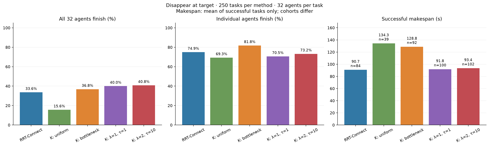

# Review of the low K-route success rates

The original 500 executions are preserved. Width-weighted selection adds 250 executions on the same frozen tasks. These checks review the measurements, actual route sets and controller/selection effects; diagnostic runs are kept separate from the benchmark averages.

## Agent completion and full-fleet success

A fleet success requires all 32 robots to finish. Agent completion counts every finished robot, including those in a run where others deadlocked. These are different metrics.

| Map | Routing | Finished agents | Agent completion | All-32 fleet successes |
| --- | --- | ---: | ---: | ---: |
| warehouse | RRT-Connect | 2455/4000 | 61.38% | 9/125 (7.2%) |
| warehouse | K routes, uniform | 2329/4000 | 58.23% | 0/125 (0.0%) |
| warehouse | K routes, bottleneck width | 2810/4000 | 70.25% | 6/125 (4.8%) |
| warehouse | K routes, edge cost (λ=1, τ=1) | 2655/4000 | 66.38% | 12/125 (9.6%) |
| warehouse | K routes, edge cost (λ=2, τ=10) | 2704/4000 | 67.60% | 15/125 (12.0%) |
| warehouse2 | RRT-Connect | 3298/4000 | 82.45% | 34/125 (27.2%) |
| warehouse2 | K routes, uniform | 2889/4000 | 72.22% | 10/125 (8.0%) |
| warehouse2 | K routes, bottleneck width | 3435/4000 | 85.88% | 29/125 (23.2%) |
| warehouse2 | K routes, edge cost (λ=1, τ=1) | 2742/4000 | 68.55% | 31/125 (24.8%) |
| warehouse2 | K routes, edge cost (λ=2, τ=10) | 2921/4000 | 73.02% | 35/125 (28.0%) |
| both maps | RRT-Connect | 5753/8000 | 71.91% | 43/250 (17.2%) |
| both maps | K routes, uniform | 5218/8000 | 65.22% | 10/250 (4.0%) |
| both maps | K routes, bottleneck width | 6245/8000 | 78.06% | 35/250 (14.0%) |
| both maps | K routes, edge cost (λ=1, τ=1) | 5397/8000 | 67.46% | 43/250 (17.2%) |
| both maps | K routes, edge cost (λ=2, τ=10) | 5625/8000 | 70.31% | 50/250 (20.0%) |

The 0% K-route fleet success on `warehouse` therefore coexists with 2,329 finished robots out of 4,000. This clarifies the magnitude of the result; it does not by itself explain the remaining difference.

## Bottleneck-width sampling: completed first map

All 125 `warehouse` tasks are complete for the new selection policy. Each agent samples one of the same up-to-five native keep-right routes once, with probability `p_i = w_i / sum(w)`, where `w_i` is the minimum full wall-to-wall cross-section along the physical reference path. The normal MPPI/ORCA controller, dynamics, speed limit, seeds, task assignments and candidate sets match the existing comparison. See the [selection protocol](../../../WAREHOUSE_BOTTLENECK_BENCHMARK.md).

| Routing on warehouse | Agent completion | All-32 fleet success | Mean successful makespan | Successful tasks |
| --- | ---: | ---: | ---: | ---: |
| RRT-Connect | 2455/4000 (61.38%) | 9/125 (7.2%) | 85.22 s | 9 |
| K routes, uniform | 2329/4000 (58.23%) | 0/125 (0.0%) | undefined | 0 |
| K routes, bottleneck width | 2810/4000 (70.25%) | 6/125 (4.8%) | 127.40 s | 6 |

Width weighting finishes 481 more agents than uniform selection on this map and increases all-32 fleet successes from zero to six. It finishes 355 more agents than RRT, while RRT completes three more full fleets. Makespan means use each method's successful tasks, so these means describe different task subsets and do not establish a paired speed advantage. The weighted runs comprise six successes and 119 deadlocks, with zero reported collisions.

All 125 weighted traces passed the independent full-trajectory, dynamics, motion-limit, continuous-collision, terminal-state, sampling and lane-geometry audit. All 11,464 candidate paths were checked. Source hashes and controller profiles match the recorded protocol. The one fleet assigned exactly the same anchors as the uniform baseline reproduced its states and controls exactly. See the [first-map audit](width_first_map/audit.json). This subsection retains the 125-task first-map cohort; both maps are now complete in the comparison below.

[First-map machine-readable summary](width_first_map/summary.json) · [Five-variant scenario averages](width_first_map/by_scenario.csv) · [Size averages](width_first_map/by_size.csv) · [Traffic-pattern averages](width_first_map/by_pattern.csv) · [Five recorded first-map GIFs](../width_evaluation/animations/FIRST_MAP.md)

## Completed weighted comparison across both maps

| Routing | Finished agents | All-32 fleet success | Mean successful makespan | Successful tasks |
| --- | ---: | ---: | ---: | ---: |
| RRT-Connect | 5753/8000 (71.91%) | 43/250 (17.2%) | 94.60 s | 43 |
| K routes, uniform | 5218/8000 (65.23%) | 10/250 (4.0%) | 156.46 s | 10 |
| K routes, bottleneck width | 6245/8000 (78.06%) | 35/250 (14.0%) | 134.21 s | 35 |

Width weighting improves individual-agent completion and full-fleet success over uniform sampling on these frozen tasks. It finishes more individual agents than RRT; RRT retains the higher full-fleet success rate. The conditional makespan means use different successful task subsets. On the nine tasks where weighted and uniform K both succeed, weighting is 2.76 s faster on average; on the 19 tasks where weighted K and RRT both succeed, weighted K is 47.35 s slower on average.

The full audit passed all 250 weighted traces, checked all 25,381 candidate paths, and rechecked the 500 baseline execution checksums. There were zero collisions or motion-limit violations. Raw weighted labels are 35 successes, 214 deadlocks and one stall. The stalled case's nearest geometric anchor projection lies behind shelving; independently checking its footprint-clear rejoin and persistent blocking graph establishes operational deadlock for every unfinished agent. Its raw label and motion remain preserved, and this additional certificate changes no success flag, arrival count or makespan. The verified outcomes are 35 successes and 215 operational deadlocks.

[Complete results, size/pattern averages and lane-policy explanation](../../../WAREHOUSE_BOTTLENECK_RESULTS.md) · [Full audit and visible-join certificate](../width_evaluation/audit.json) · [Raw and verified per-run outcomes](../width_evaluation/comparison_runs.csv) · [Paired comparisons](../width_evaluation/paired_comparisons.csv) · [Recorded GIF gallery](../width_evaluation/animations/README.md)

### Full replay: RRT success and both K policies deadlocked

[Open the complete synchronized GIF](../width_evaluation/full_replays/warehouse_s13_v02/warehouse_s13_v02__rrt_vs_both_k_routes__full.gif) for `warehouse_s13_v02`: RRT finishes 32/32 agents in 39.2 s; uniform K finishes 25/32 and deadlocks at 61 s; width-weighted K finishes 28/32 and deadlocks at 69 s. The same starts, goals, 32 radius-0.4 m robots and controller settings are used in all three columns.

The GIF includes all 691 recorded 0.1 s steps at 1× playback, with every selected anchor, every executed trail, agent IDs, and the same close-up region. Terminated panels hold their final recorded poses. The recordings were checked against their original audit hashes; no simulation was rerun. This is the shortest full recording among the 24 tasks where RRT succeeds and both K policies fail. [Replay details and reproduction](../width_evaluation/full_replays/warehouse_s13_v02/README.md).

## Actual K and sampling

Requested K was 5. The returned-set sizes were:

| Map | 1 route | 2 routes | 3 routes | 4 routes | 5 routes | Mean returned K |
| --- | ---: | ---: | ---: | ---: | ---: | ---: |
| warehouse | 593 | 1346 | 887 | 352 | 822 | 2.866 |
| warehouse2 | 538 | 603 | 677 | 768 | 1414 | 3.479 |

Only 2,236/8,000 queries returned five routes. All 8,000 saved uniform choices replay correctly, including their `1 / available` probabilities. Fewer returned routes are not a certificate that further feasible alternatives do not exist: the bounded candidate search and diversity/detour filters can limit the set. Increasing the candidate budget from 24 to 128 on 64 fixed queries increased the returned count on five queries; this limited check does not establish a fleet-performance effect.

## Full path tracking without traffic

All 128 solo checks completed their full recorded anchor paths with zero collisions or motion-limit violations. They cover every robot on both routing methods for `warehouse_s01_v04` and `warehouse2_s01_v01`, using the recorded controller profiles. The six additional opposing-lane checks also finished safely, including a 1.5 m corridor. These checks provide evidence against a basic path-tracking or lane-passing defect on the tested paths; they do not cover all 8,000 assignments.

## Added waiting-policy ablation

The same four frozen runs were repeated with only `anchor_yield_after` changed from 15 seconds to 0 (disabled). Anchors, native code and all other profile fields match.

| Task | Routing | Finished with waiting | Finished without waiting | Outcome without waiting |
| --- | --- | ---: | ---: | --- |
| warehouse2_s01_v01 | k_routes | 26/32 | 26/32 | deadlock |
| warehouse2_s01_v01 | rrt | 31/32 | 31/32 | deadlock |
| warehouse_s01_v04 | k_routes | 25/32 | 25/32 | deadlock |
| warehouse_s01_v04 | rrt | 26/32 | 26/32 | deadlock |

The completed-agent counts and fleet outcomes were unchanged in these four cases. Their deadlock detection times can differ. The waiting policy does not explain those four failures; this is not an ablation across the full suite.

## Route-assignment ablation

Both K treatments below use the same controller profile with the added waiting policy disabled. The treatment changes only which path is chosen from the same returned candidate sets. This diagnostic shortest-route choice is separate from the requested uniform-selection benchmark.

| Task | RRT finished | Uniform K finished | Shortest returned K finished |
| --- | ---: | ---: | ---: |
| warehouse2_s01_v01 | 31/32 | 26/32 | 31/32 |
| warehouse_s01_v04 | 26/32 | 25/32 | 28/32 |

All six fleet runs in this table still ended in deadlock; the improved counts are individual-agent completions. The route-selection intervention shows that assignment can materially affect these two outcomes. It does not establish a general success rate for shortest-route selection.

Uniform K anchors were longer on average:

| Map | RRT mean path length (m) | Uniform K mean path length (m) |
| --- | ---: | ---: |
| warehouse | 42.07 | 54.66 |
| warehouse2 | 48.68 | 69.86 |

Longer, more diverse routes create additional traffic exposure. That is a plausible contributor, rather than an isolated explanation of the full gap.

## Scope of the comparison

The benchmark uses modified MPPI/ORCA with a shared synchronous braking-safety filter, bounded control feedback, anchor guidance and an added waiting policy. Both routers use that same controller. The measurements describe this complete system, with planner-selection and controller seeds fixed at 42. They do not establish a controller-independent ranking of global planners. The shared safety filter was retained in these diagnostics; its effect has not been isolated. Finished robots remain parked as physical obstacles.

No arithmetic or uniform-sampling error was found in this review. The 500-run rates remain the measured rates for the documented protocol. The report now presents agent completion and all-32 fleet success together, and explicitly reports actual returned K rather than only requested K.

## Data and reproduction

[Benchmark results](REPORT.md) · [Machine-readable review](comparison_review.json) · [Actual route counts](route_availability.csv)

Raw diagnostic trajectories and scripts are retained under `benchmarks/results/warehouse_comparison_audit/`. From the project root:

```bash
.venv/bin/python benchmarks/results/warehouse_comparison_audit/reproduction/no_wait_ablation.py
.venv/bin/python benchmarks/results/warehouse_comparison_audit/reproduction/candidate_budget_check.py
.venv/bin/python benchmarks/results/warehouse_comparison_audit/reproduction/passing_controller_check.py
.venv/bin/python benchmarks/results/warehouse_comparison_audit/reproduction/solo_anchor_check.py
.venv/bin/python benchmarks/results/warehouse_comparison_audit/reproduction/shortest_route_counterfactual.py
```

## Edge-cost sampling benchmark (λ = τ = 1)

| Method | Tasks | Fleet successes | Fleet success | Agent completion | Successful makespan (s) |
| --- | ---: | ---: | ---: | ---: | --- |
| RRT-Connect | 250 | 43 | 17.2% | 71.91% | 94.6 ± 21.2 (n=43) |
| K routes, uniform | 250 | 10 | 4.0% | 65.22% | 156.5 ± 27.1 (n=10) |
| K routes, bottleneck width | 250 | 35 | 14.0% | 78.06% | 134.2 ± 35.4 (n=35) |
| K routes, edge cost (λ=τ=1) | 250 | 43 | 17.2% | 67.46% | 96.1 ± 22.2 (n=43) |

| Map | Method | Tasks | Fleet successes | Fleet success | Agent completion | Successful makespan (s) |
| --- | --- | ---: | ---: | ---: | ---: | --- |
| warehouse | RRT-Connect | 125 | 9 | 7.2% | 61.38% | 85.2 ± 28.8 (n=9) |
| warehouse | K routes, uniform | 125 | 0 | 0.0% | 58.23% | — (0 successes) |
| warehouse | K routes, bottleneck width | 125 | 6 | 4.8% | 70.25% | 127.4 ± 11.7 (n=6) |
| warehouse | K routes, edge cost (λ=τ=1) | 125 | 12 | 9.6% | 66.38% | 85.1 ± 17.9 (n=12) |
| warehouse2 | RRT-Connect | 125 | 34 | 27.2% | 82.45% | 97.1 ± 18.5 (n=34) |
| warehouse2 | K routes, uniform | 125 | 10 | 8.0% | 72.22% | 156.5 ± 27.1 (n=10) |
| warehouse2 | K routes, bottleneck width | 125 | 29 | 23.2% | 85.88% | 135.6 ± 38.5 (n=29) |
| warehouse2 | K routes, edge cost (λ=τ=1) | 125 | 31 | 24.8% | 68.55% | 100.4 ± 22.4 (n=31) |

[Four-method results, scenario averages and audit](../edge_cost_evaluation/REPORT.md). Makespan means use successful runs only; paired comparisons are provided in the linked report.

## Parameterised edge-cost experiments

| Method | Tasks | Fleet successes | Fleet success | Agent completion | Successful makespan (s) |
| --- | ---: | ---: | ---: | ---: | --- |
| RRT-Connect | 250 | 43 | 17.2% | 71.91% | 94.6 ± 21.2 (n=43) |
| K routes, uniform | 250 | 10 | 4.0% | 65.22% | 156.5 ± 27.1 (n=10) |
| K routes, bottleneck width | 250 | 35 | 14.0% | 78.06% | 134.2 ± 35.4 (n=35) |
| K routes, edge cost (λ=1, τ=1) | 250 | 43 | 17.2% | 67.46% | 96.1 ± 22.2 (n=43) |
| K routes, edge cost (λ=2, τ=10) | 250 | 50 | 20.0% | 70.31% | 99.2 ± 21.4 (n=50) |

| Map | Method | Tasks | Fleet successes | Fleet success | Agent completion | Successful makespan (s) |
| --- | --- | ---: | ---: | ---: | ---: | --- |
| warehouse | RRT-Connect | 125 | 9 | 7.2% | 61.38% | 85.2 ± 28.8 (n=9) |
| warehouse | K routes, uniform | 125 | 0 | 0.0% | 58.23% | — (0 successes) |
| warehouse | K routes, bottleneck width | 125 | 6 | 4.8% | 70.25% | 127.4 ± 11.7 (n=6) |
| warehouse | K routes, edge cost (λ=1, τ=1) | 125 | 12 | 9.6% | 66.38% | 85.1 ± 17.9 (n=12) |
| warehouse | K routes, edge cost (λ=2, τ=10) | 125 | 15 | 12.0% | 67.60% | 93.0 ± 17.9 (n=15) |
| warehouse2 | RRT-Connect | 125 | 34 | 27.2% | 82.45% | 97.1 ± 18.5 (n=34) |
| warehouse2 | K routes, uniform | 125 | 10 | 8.0% | 72.22% | 156.5 ± 27.1 (n=10) |
| warehouse2 | K routes, bottleneck width | 125 | 29 | 23.2% | 85.88% | 135.6 ± 38.5 (n=29) |
| warehouse2 | K routes, edge cost (λ=1, τ=1) | 125 | 31 | 24.8% | 68.55% | 100.4 ± 22.4 (n=31) |
| warehouse2 | K routes, edge cost (λ=2, τ=10) | 125 | 35 | 28.0% | 73.02% | 101.8 ± 22.4 (n=35) |

[Complete comparison and audit](../edge_cost_l2_t10_evaluation/REPORT.md).

## Recorded disappearance failure: warehouse2_s02_v02

On the same 32-agent task (diameter 0.6 m), RRT-Connect finished all agents in 53.9 s. Uniform K routes finished 5/32, bottleneck sampling 17/32, edge cost λ=1, τ=1 finished 8/32, and λ=2, τ=10 finished 10/32; all four K variants ended in audited mutual deadlock. Finished robots disappear. At the measured 0.83754 m bottleneck, RRT assigned 4 routes, compared with 26 for λ=1, τ=1, in opposing directions. Agent 23 has only one returned K candidate through that bottleneck; its RRT path avoids the section.

[Diagnosis, all-method full replay and measurements](../disappear_evaluation/full_replays/warehouse2_s02_v02/DIAGNOSIS.md).

[Cause of missing wide alternatives](../disappear_evaluation/full_replays/warehouse2_s02_v02/CANDIDATE_FILTER.md). Planning-only tests isolate the pre-lane detour limit of 1.8: the permitted reference length is 43.53 m, while the wide alternatives measure 45.96 and 46.33 m. Changing only the ratio to 2.0 returns three certified candidates; expanding the search budget alone does not restore the wide alternatives.

## Open-route rerun: warehouse2_s02_v02

| Method | Old finished | New finished | New result | New makespan |
| --- | ---: | ---: | --- | ---: |
| RRT-Connect | 32/32 | 32/32 | success | 53.9 s |
| K routes, uniform | 5/32 | 10/32 | deadlock | undefined |
| K routes, bottleneck | 17/32 | 16/32 | deadlock | undefined |
| K routes, lambda=1, tau=1 | 8/32 | 8/32 | deadlock | undefined |
| K routes, lambda=2, tau=10 | 10/32 | 10/32 | deadlock | undefined |

Same task and controller; new K=5 pool per agent, no binding length cutoff, 128 candidate attempts, paired random numbers. One execution per method.

[Complete report and audit](../disappear_evaluation/open_routes/warehouse2_s02_v02/REPORT.md).

## Disappear-at-target benchmark

### Disappear-at-target only

| Method | Tasks | Fleet successes | Fleet success | Agent completion | Successful makespan (s) |
| --- | ---: | ---: | ---: | ---: | --- |
| RRT-Connect | 250 | 84 | 33.6% | 74.91% | 90.7 ± 23.4 (n=84) |
| K routes, uniform | 250 | 39 | 15.6% | 69.30% | 134.3 ± 42.6 (n=39) |
| K routes, bottleneck width | 250 | 92 | 36.8% | 81.81% | 128.8 ± 41.2 (n=92) |
| K routes, edge cost (λ=1, τ=1) | 250 | 100 | 40.0% | 70.55% | 91.8 ± 27.2 (n=100) |
| K routes, edge cost (λ=2, τ=10) | 250 | 102 | 40.8% | 73.20% | 93.4 ± 26.7 (n=102) |

| Map | Method | Tasks | Fleet successes | Fleet success | Agent completion | Successful makespan (s) |
| --- | --- | ---: | ---: | ---: | ---: | --- |
| warehouse | RRT-Connect | 125 | 26 | 20.8% | 64.30% | 88.4 ± 27.8 (n=26) |
| warehouse | K routes, uniform | 125 | 14 | 11.2% | 62.92% | 114.6 ± 49.8 (n=14) |
| warehouse | K routes, bottleneck width | 125 | 28 | 22.4% | 74.52% | 110.9 ± 49.3 (n=28) |
| warehouse | K routes, edge cost (λ=1, τ=1) | 125 | 43 | 34.4% | 70.20% | 82.5 ± 29.2 (n=43) |
| warehouse | K routes, edge cost (λ=2, τ=10) | 125 | 44 | 35.2% | 71.03% | 84.4 ± 28.3 (n=44) |
| warehouse2 | RRT-Connect | 125 | 58 | 46.4% | 85.52% | 91.7 ± 21.3 (n=58) |
| warehouse2 | K routes, uniform | 125 | 25 | 20.0% | 75.67% | 145.4 ± 34.3 (n=25) |
| warehouse2 | K routes, bottleneck width | 125 | 64 | 51.2% | 89.10% | 136.7 ± 34.7 (n=64) |
| warehouse2 | K routes, edge cost (λ=1, τ=1) | 125 | 57 | 45.6% | 70.90% | 98.8 ± 23.6 (n=57) |
| warehouse2 | K routes, edge cost (λ=2, τ=10) | 125 | 58 | 46.4% | 75.38% | 100.3 ± 23.3 (n=58) |

.

### Comparison with stay-at-target

| Method | Park: fleet success | Disappear: fleet success | Change | Agent completion: park → disappear | Successful makespan: park → disappear (s) |
| --- | ---: | ---: | ---: | ---: | ---: |
| RRT-Connect | 43/250 (17.2%) | 84/250 (33.6%) | +16.4 pp | 71.9% → 74.9% | 94.6 → 90.7 |
| K routes, uniform | 10/250 (4.0%) | 39/250 (15.6%) | +11.6 pp | 65.2% → 69.3% | 156.5 → 134.3 |
| K routes, bottleneck width | 35/250 (14.0%) | 92/250 (36.8%) | +22.8 pp | 78.1% → 81.8% | 134.2 → 128.8 |
| K routes, edge cost (λ=1, τ=1) | 43/250 (17.2%) | 100/250 (40.0%) | +22.8 pp | 67.5% → 70.5% | 96.1 → 91.8 |
| K routes, edge cost (λ=2, τ=10) | 50/250 (20.0%) | 102/250 (40.8%) | +20.8 pp | 70.3% → 73.2% | 99.2 → 93.4 |

Robots disappear after physically settling at their targets. Controller settings and sampled paths are unchanged. Successful-makespan means use different successful cohorts; matched-task comparisons are in the full report.

[Complete results, per-map tables, five-variant averages, standalone figures and audit](../disappear_evaluation/REPORT.md).
