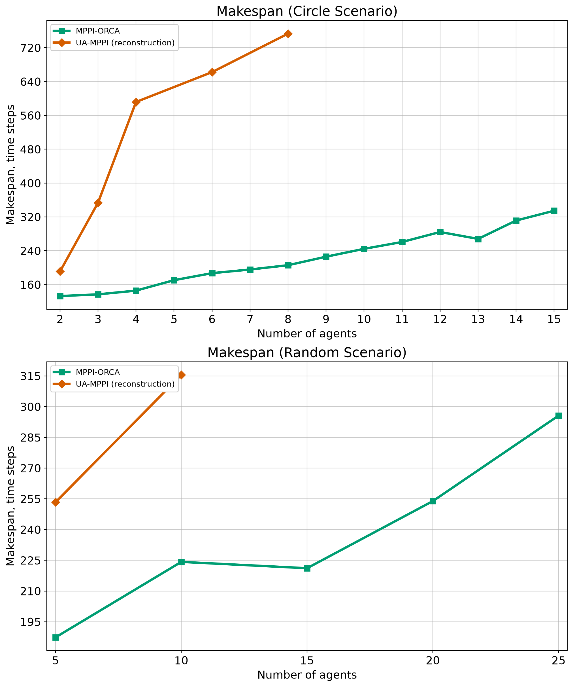

# Table I and Figure 3 — local measurements

**Historical run with a sampler implementation error.** This experiment used
rejection sampling in place of Gaussian rollout proposals. Its raw measurements
are preserved, but they do not validate the paper's algorithm or the corrected
controller. See the [implementation audit](../../reproduction/AUDIT.md) for the
correction and paired diagnostic replays.

Completed **1280/1280 runs**, with 140 Circle and 500 Random runs per method.

| Algorithm | Circle SR | Circle % Col. | Random SR | Random % Col. |
|---|---:|---:|---:|---:|
| MPPI-ORCA | 99.3% | 0.7% | 97.2% | 2.8% |
| UA-MPPI (reconstruction) | 37.9% | 0% | 44.8% | 5.8% |

SR is the fraction of runs where every robot reached its goal without a collision. % Col. is the fraction of all runs that terminated due to collision. Timeouts count as failures.

Makespan is the mean number of simulation time steps among successful runs at each agent count. One step is 0.1 s. A point is included only when strictly more than 50% of that method's runs at that count succeeded; missing points do not mean zero makespan.

Circle: diameter 12 m, every integer agent count from 2 through 15, ten repetitions. Random: 20 × 20 m, counts 5/10/15/20/25, ten instances per count, ten repetitions each. Both methods use the same saved instance geometry, environment noise seeds, 1000-step limit, 0.4 m goal tolerance, physical limits and noise model.

The scenario grid, table columns, makespan units, line colors/markers and success inclusion rule follow [Table I and Figure 3 in the paper](https://arxiv.org/html/2507.20293v2#S6.F3). The original instances and complete controller settings were not published; these measurements use this repository's documented reconstruction and newly generated saved instances. MPPI-ORCA uses the original PID/time-seeded global controller RNG; its internal samples cannot be replayed from the environment seed.

Exports: `table_i.{md,csv,tex,png,pdf,svg}`, `figure_3.{png,pdf,svg}`, `makespan_circle.{png,pdf,svg}`, `makespan_random.{png,pdf,svg}`, `per_count_metrics.csv`, `runs.jsonl`, `manifest.json`, and `instances.npz`.
